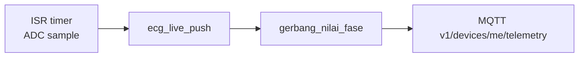

# Feature docs

The repo bans code comments (skill `tanpa-komentar-kode`), so the "why" behind code lives in a document. A page that is wrong or points at the wrong line is worse than no page, because agents and the user trust it to jump straight into the code. Everything below serves that: specific, current, verifiable.

## Where things live

| What | Where |
|---|---|
| One page per feature | `docs/features/<feature>.md` |
| Index and registration | `docs/README.md` (one line per page) |
| Model pipeline deep dives | `model/docs/*-walkthrough.md` (map in `model/docs/README.md`) |
| Build, flash, test quickstart, modules, serial commands | `firmware/README.md` |
| Pin map and circuit rationale | `hardware/mainboard/README.md` |
| Decisions and traps for the model | `model/CLAUDE.md` |

A feature page links to these instead of copying them. `laporan/` is out of scope: the thesis text has its own rules (`laporan/CLAUDE.md`) and never receives Mermaid.

## Pick the mode

**Update mode** (a page for the feature exists; the common case):

1. Read the whole existing page first, then the code it describes. You need both to know what changed.
2. Change only what the code changed. Keep sections that are still true word for word, so the diff reviews quickly and nobody loses knowledge you could not re-derive.
3. Re-verify every `file:line` pointer in the sections you touch (see below), and run the pointer audit on the whole page so stale ones elsewhere get reported.
4. If a claim in a section you are touching can no longer be confirmed in the code, drop it from the page and list it in the final report. This includes runtime observations the code cannot prove (latencies such as "the upload usually finishes in 2 seconds", hit rates, typical counts) unless a constant in the code or a recorded measurement file states them. Keeping such a line untouched in an edited row still counts as asserting it. Do not leave "not verified" banners or TODOs in the page; they rot and readers cannot act on them.
5. A stale pointer in a section you are not otherwise changing is NOT edited: list it in the final report as `file:line -> actual line` from the grep you have, or as unchecked if you have no grep for it. Reason: touching untouched sections buries the real change in the diff and risks writing a guess.
6. Never write placeholders (`[N]`, TODO, "unverified") into a page; they belong only in the final report. Reason: a placeholder in a page is read as fact or rots there.
7. Frozen data-contract tokens (`SIMPAN`, `---MULAI---`, NVS keys, MQTT keys) in a touched row stay unless the code no longer has them. Reason: scripts and readers match on those exact strings.
8. Never delete a page. If a feature was removed, say so in the report and let the user decide; other pages and `docs/README.md` may still link to it.

**Create mode** (no page covers the feature and it is big enough to have its own data flow): write a new `docs/features/<kebab-name>.md` from the skeleton below, then register it. A small addition to an existing feature (one serial command, one NVS key, one menu entry) goes into that feature's page; a new page for it fragments the docs.

Either way, explore the real code before writing: the `.cpp` and its header, the caller in `main.cpp` or `menu.cpp`, the constants, the Python module and its test. Every sentence should be about this code; if a sentence would fit any project, cut it.

## Page skeleton

Drop sections that do not apply; do not add empty ones.

````markdown
# <Feature name>

<1-3 sentences: what the feature does and the one invariant a reader must not break, in bold.
E.g. "**The calibration gate never lets a beat reach the classifier before contact quality is good.**">



## How it works

Present-tense prose and tables: the stages, the constants with their names and values, the rule behind each threshold.

## Interfaces

| Interface | Details |
|---|---|
| Serial `<command>` (`file.cpp:<line>`, `function`) | What it does and prints. |
| Menu "Sumber sinyal" (signal source) | Where in `menu.cpp` and what it toggles. |

## Limits and out of scope

- What the feature deliberately does not do.

**Code:** `firmware/include/<name>.h` · `firmware/src/<name>.cpp` · `model/scripts/<file>.py` · tests `firmware/test/<dir>/`
````

Conventions inside the skeleton:

- **The `**Code:**` footer** ends every page: paths in backticks separated by ` · `, grouped by layer (header, implementation, caller, model, tests). No emoji marker; the repo bans marker emoji in docs.
- **Code paths are inline code.** Links to files outside `docs/` are dead links in the link check; inline code is safe.
- **Links between docs** are relative with the `.md` extension: `[Recorder](./recording.md)`, `[firmware walkthrough](../../model/docs/firmware-walkthrough.md)`. `scripts/check_docs.py` fails on a link whose target does not exist.
- **Tables** for interface lists and decision matrices; bullets for rules; prose for the "why".

## `file:line` pointers

A pointer is a promise that the line shows the thing named. Line numbers drift with every edit, so never copy one from the old page or from memory.

- Find it fresh: `grep -n "function_name\|CONSTANT" firmware/src/file.cpp` and point at the declaration or definition (the function signature, the `constexpr`, the `def`), not at a line in the middle of the body.
- Always name the symbol next to the line (`` `gerbang_nilai_fase`, `:60` ``), so a reader can still grep for it after the line moves.
- After the file is named once in a paragraph or table, later pointers in that block can be short: `` (`:83`) ``, ranges `` `:195-219` ``.
- Pointers use a repo-relative path or a unique basename ending in `.cpp`, `.h`, `.py`, `.sh`, `.ini`, `.yml`, `.md`, or `Makefile:<line>`.
- Audit a whole page with the bundled script; it resolves short names against `git ls-files` and prints the line each pointer lands on:

  ```bash
  .claude/skills/feature-docs/scripts/pointers.sh docs/features/<feature>.md
  ```

  Read the output: a pointer whose printed line is not the named symbol is stale (fix it in update mode for sections you touch, report the rest); `MISSING` means the file was renamed or removed; `AMBIGUOUS` means the short name matches several files, so write a longer path.

## Mermaid

Allowed only in `docs/features/`, never in `laporan/`.

- `flowchart LR` per feature for its pipeline; `sequenceDiagram` only when timing between tasks matters.
- Node labels in double quotes, line breaks with `<br/>`; storage as cylinders `Store[("LittleFS /rekam")]`; edge labels `A -- "queue full" --> B`; dotted `-.->` for optional or async paths.
- Labels name real things: the ISR, function names such as `ecg_live_push`, the MQTT topic, serial commands, file names. A box that says "Processing" teaches nothing.
- Every node used in a `subgraph` or `class` line must be defined; Mermaid silently draws undefined ids as empty boxes.
- One diagram per flow, near the top; a feature page with a non-trivial flow gets one.

## Register a page

1. Add one line to the table in `docs/README.md`: date, `[<name>](features/<name>.md)`, one-sentence content, status. The link uses the path relative to `docs/`.
2. New serial commands, menu entries or build steps also go into `firmware/README.md`; new pipeline stages into `model/docs/README.md`. The feature page links there instead of duplicating.
3. Run `python3 scripts/check_docs.py`; the line you added must resolve.

## What a page contains, and what it does not

- **The current system only, in present tense.** No changelogs, no "since 20 Okt 2026" notes, no "replaces the old X" stories, no test-run diaries. History lives in `git log`, where the commit message carries the evidence. A reader opens a page to learn how the code works now; dated notes make them guess which parts still apply. Measurement metadata (board, date of a measurement file) is the only allowed date.
- **Explain the why as a present-tense reason.** Write "The gate waits for 30 s of plausible RR intervals so a loose electrode cannot start classification", not "added after the S02 session".
- **No generic text and no fluff.** No intro about the importance of docs, no closing summary. Do not restate the code line by line; say what is not obvious from reading it. No marketing buzzwords.
- **Omit what you cannot verify** in the repo code. Report the omission instead of hedging in the page.
- **A page never says what it does not cover or why** ("not listed here because the grep did not include ...", "see the report", "[N]", TODO, "unverified"). Gaps go only in the final report. Reason: a gap note in a page is a placeholder that rots there and tells the reader nothing about the system.
- No pointers to plans or specs that will be deleted once done; the page is the reference.
- In update mode, rewrite history notes only inside sections you are already changing, and list the remaining ones in the report, so the diff stays reviewable.

## Language

- English for every page, heading, diagram label and explanation. No em dash character; use a comma, colon or parentheses.
- TFT and menu labels are Indonesian strings in the code. Quote the label and gloss it once: "Sumber sinyal" (signal source).
- Frozen data-contract tokens stay verbatim: serial `SIMPAN`, `---MULAI---`, NVS keys, MQTT keys, CSV headers. Quote them in inline code.
- Code identifiers stay verbatim even when Indonesian (`gerbang_nilai_fase`, `AMBANG_AYUN`).
- Translating a leftover Indonesian page is an update: keep the structure and pointers, re-verify the pointers, translate the prose.

## Verify

```bash
python3 scripts/check_docs.py
.claude/skills/feature-docs/scripts/pointers.sh docs/features/<feature>.md
```

`check_docs.py` walks every tracked `.md` outside `laporan/` and prints `file:line: missing target <target>` plus a count; it must report `0 missing link targets`. Put both outputs (or their last lines) in the commit message as evidence (repo rule: every commit carries evidence). One feature per commit: the docs change goes in the same commit as the code it documents or right after it.

## Final report

End with this, in the chat (not in a file). The final report is the last thing in the answer, with nothing after it. Reason: the coordinator and the user read the end of the answer for status, and trailing text hides it.

```
Docs: <created | updated> <paths>
Registered: docs/README.md <line added> · firmware/README.md / model/docs/README.md if touched
Preserved unchanged: <sections kept as they were>
Pointers: <n> re-verified · stale outside the edited sections: <file:line -> actual line>
Omitted (could not verify in code): <claim> (<why>)
History notes left in untouched sections: <page:line>
Possibly obsolete: <pages or sections describing removed code> (not deleted)
Diagrams: <n> Mermaid flowcharts, nodes named after real symbols
Link check: python3 scripts/check_docs.py -> <result or [N] if not run>
Pointer audit: pointers.sh <page> -> <result or [N] if not run>
```
