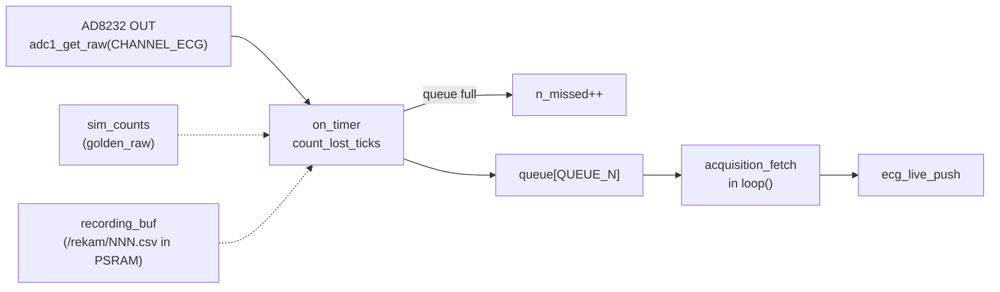

# Acquisition

A 360 Hz hardware timer interrupt reads one ADC sample (or the next replay sample) into a small queue that `loop()` drains. **The ISR never does float math and never waits: a full queue or a late tick is counted, never silently dropped.**

## How it works

### Timer and queue

`acquisition_begin` (`acquisition.cpp:58`, `acquisition_begin`) sets up a 1 MHz hardware timer with an alarm every `1000000 / ECG_FS` ticks (`ECG_FS` = 360) and attaches `on_timer` (`:44`, `on_timer`). `on_timer` pushes one `uint16_t` into the ring `queue` of `QUEUE_N` = 256 samples (`acquisition.h:7`, `QUEUE_N`, 711 ms of signal). When the next write slot equals the read index, the sample is skipped and `n_missed` increments. `acquisition_fetch` (`acquisition.cpp:75`, `acquisition_fetch`) is the only consumer.

The ISR has no float operation. ESP32 does not save FPU registers in the interrupt context, so a float in the ISR corrupts the state of the interrupted task. The reference signal is therefore converted once, in `acquisition_begin`, from millivolts to ADC counts (`SCALE_REPLAY` = 1000 counts per mV and `OFFSET_REPLAY` = 2048, clamped to 0..4095, `:29-30`) into `sim_counts`.

### Lost ticks

A flash write (LittleFS, NVS) holds the interrupt because the timer is attached with `timerAttachInterrupt` and no IRAM flag (`:67`). Alarms that fall due during the write merge into one interrupt afterwards: those samples are never taken and the queue does not overflow, so the queue counter alone reports 0. `count_lost_ticks` (`:34`, `count_lost_ticks`) compares `esp_cpu_get_ccount()` between interrupts with `cycles_per_sample` (CPU frequency / 360); an interval above 1.5 sample periods adds the missing ticks to `n_tick_lost`.

`acquisition_missed` (`:84`, `acquisition_missed`) returns overflow plus lost ticks. The recording header (`lewat=`), the calibration status page and the serial status line report it; `acquisition_zero_missed` resets both counters.

### Signal sources

| Source | Constant | Data in the ISR |
|---|---|---|
| Sensor | `SOURCE_ADC` | `adc1_get_raw(CHANNEL_ECG)` (`:53`) |
| Reference replay ("REPLAY 208") | `SOURCE_REFERENCE` | `sim_counts`, `GOLDEN_N` samples from `golden_ref.h`, looped |
| Recording replay ("Replay rekaman", recording replay) | `SOURCE_RECORDING` | `recording_buf` in PSRAM (`RECORDER_SAMPLE_MAX` samples), loaded by `recorder_load`, looped |

Replay reads a PSRAM buffer inside the ISR. That is safe because the ISR is held during flash writes (see above), so it never runs while flash is being written.

`attach_source` (`:98`, `attach_source`) selects the source. A recording shorter than `ECG_FS` samples fails to load and the previous source stays. `acquisition_set_source` (`:122`, `acquisition_set_source`) is the public switch:

1. `recorder_reject` refuses the change while a recording is running.
2. The timer stops, the source attaches, the timer restarts.
3. With `save` set, the choice is stored in NVS (`settings_set_source`, `app_settings.cpp:133`, keys `sumber` and `rekam`); `acquisition_begin` restores it at boot and falls back to the sensor if the stored source cannot load.
4. A new calibration session starts (`gate_begin_session`) and the classifier statistics reset (`classifier_reset`).

The serial command `y` toggles between sensor and reference replay (`acquisition_switch_source`, `acquisition.cpp:139`). The menu entry "Sumber sinyal" (signal source, `menu.cpp:75`, `H_SOURCE`) calls `acquisition_set_source` for all three sources. `acquisition_replay` reports any source other than the sensor; the [calibration gate](./calibration-gate.md) skips the lead-off check and the warm-up when it is true.

### Board bring-up and pins

`board_begin` (`board.cpp:32`, `board_begin`) is the first call in `setup()`. Its order is fixed: `SPI.begin(TFT_SCK, WITHOUT_MISO, TFT_MOSI)` first, then the buzzer attaches to LEDC (`attach_buzzer`, `:12`), then the lead-off pins, buttons, ADC and TFT. On ESP32-S3 a MISO of -1 is replaced by the default FSPI MISO, which is GPIO 13 and becomes an input; attaching the buzzer to LEDC before `SPI.begin` would lose the pin. The ADC is 12 bit with 12 dB attenuation (`board.cpp:42-43`).

| Function | GPIO | Constant (`board.h`) |
|---|---|---|
| AD8232 OUT | 1 (ADC1_CH0) | `CHANNEL_ECG` (`board.h:8`) |
| AD8232 LO+ / LO- | 42 / 2, internal pull-up, 1 = electrode off | `PIN_LOP`, `PIN_LON` (`:9`) |
| TFT SCK / MOSI / RST / DC | 9 / 8 / 10 / 11 (CS to GND, BLK to 3V3) | `TFT_SCK` (`:11`) |
| Buzzer (passive module, active LOW) | 13 | `PIN_BUZZ` (`:14`) |
| Buttons B1 / B2 / B3 | 4 / 5 / 6, internal pull-up | `PIN_BTN` (`:17`) |
| INA219 SDA / SCL | 17 / 18 | `I2C_SDA` (`:19`) |
| NeoPixel | 48 | `PIN_LED` (`:22`) |

The LO pins use `INPUT_PULLUP`, so a broken LO wire reads HIGH (electrode off) instead of floating. The LO outputs of the AD8232 are push-pull, so the pull-up does not fight them.

## Interfaces

| Interface | Details |
|---|---|
| Serial `y` (`serial_cmd.cpp:99`) | Toggles sensor and reference replay and stores the choice. |
| Menu "Sumber sinyal" (signal source) | Sensor (ADC), "REPLAY 208", or a numbered recording. |
| NVS keys `sumber`, `rekam` | Source and recording number restored at boot. |

See [Display and buzzer](./display-and-buzzer.md) for the buzzer and LED behavior, [Recording](./recording.md) for the files replayed here, [Network settings](./network-settings.md) for the NVS-backed choices, and the [acquisition walkthrough](../../model/docs/acquisition-walkthrough.md) for recording body signals.

## Limits and out of scope

- The queue holds 256 samples; a processing stall longer than 711 ms overflows it and the count appears in `acquisition_missed`.
- Replay data is copied into RAM or PSRAM first; the ISR never reads from LittleFS.

**Code:** `firmware/include/acquisition.h` · `firmware/include/board.h` · `firmware/src/acquisition.cpp` · `firmware/src/board.cpp` · callers `firmware/src/main.cpp` · `firmware/src/menu.cpp` · `firmware/src/serial_cmd.cpp` · tests `firmware/test/test_hw_adc/` · `firmware/test/test_hw_integration/`
