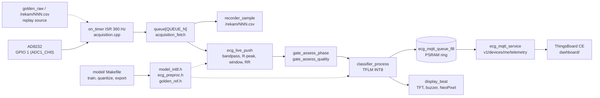

# System architecture

The device samples one ECG lead, detects R-peaks and classifies every beat on the ESP32-S3 itself, then sends one result per beat to ThingsBoard. **Classification runs on the device; the server only stores and displays results.**

## How it works

Everything runs on one Arduino loop plus one timer interrupt. `setup()` (`main.cpp:43`, `setup`) brings the board up first so the buzzer stays silent from boot, then attaches the MQTT ring in PSRAM, starts the classifier, opens a calibration session and starts the 360 Hz timer. `loop()` (`:83`, `loop`) drains the sample queue one sample at a time:

1. `recorder_sample` stores the raw sample when a recording is running.
2. `ecg_live_push` filters the sample and returns a beat when one is ready.
3. `gate_assess_quality` updates the per-second signal quality; `gate_assess_phase` runs when a beat is ready.
4. During the calibration phase `gate_report_calibration` is called; in the other phases `classifier_process` classifies the beat and may publish it.
5. `display_beat` and `display_sample` draw the beat and the waveform.

After the sample block, the same iteration services the recorder, MQTT, power measurement, serial commands, buttons, menu and display. The stages `power_stage(2)`, `power_stage(3)` and `power_stage(4)` (`power.cpp:35`, `power_stage`) switch signal processing, classification and display off one by one for the power measurement ladder.

| Stage | Module | Page |
|---|---|---|
| Sampling, sources | `acquisition.cpp`, `board.cpp` | [Acquisition](./acquisition.md) |
| Filter, R-peak, window, RR | `ecg_pipeline.cpp`, `ecg_live.cpp` | [Signal pipeline](./signal-pipeline.md) |
| Signal quality, calibration | `gate.cpp` | [Calibration gate](./calibration-gate.md) |
| Inference | `classifier.cpp` | [Classification](./classification.md) |
| TFT, buzzer, NeoPixel | `display.cpp` | [Display and buzzer](./display-and-buzzer.md) |
| Buttons, menu | `buttons.cpp`, `menu.cpp` | [Buttons and menu](./buttons-and-menu.md) |
| Raw recording | `recorder.cpp` | [Recording](./recording.md) |
| WiFi, broker, NVS choices | `app_settings.cpp` | [Network settings](./network-settings.md) |
| Serial command interface | `serial_cmd.cpp` | [Serial commands](./serial-commands.md) |
| Telemetry | `ecg_mqtt.cpp` | [MQTT telemetry](./mqtt-telemetry.md) |
| INA219, power ladder | `power.cpp`, `ina219.cpp` | [Power measurement](./power-measurement.md) |
| Device self-tests | `diagnostics.cpp` | [Diagnostics](./diagnostics.md) |

### Model side

`model/` trains the CNN on MIT-BIH, quantizes it to INT8 and exports firmware inputs (see [Model pipeline](./model-pipeline.md)). Three generated headers connect the two sides, and none of them is edited by hand:

| Header | Producer | Consumer |
|---|---|---|
| `firmware/include/model_int8.h` | `model/scripts/export_model_h.py`, run by `make export` (`model/Makefile:39`, `export`) through `scripts/export_artifacts.sh` | `classifier.cpp` |
| `firmware/include/ecg_preproc.h` | `model/scripts/export_golden.py` (`export_golden.py:48`, `main`) | `ecg_pipeline.cpp`, `ecg_live.cpp`, `recorder.h` |
| `firmware/test/golden_ref.h` | `export_golden.py` | `test_preproc`, `test_inference`, `test_hw_integration`, replay source in `acquisition.cpp` |

`golden_ref.h` is a regression reference: it fixes that C and Python compute the same values, not that the parameters are optimal. After changing a preprocessing parameter in Python, regenerate with `python scripts/export_golden.py` from `model/` and run `pio test -e native`.

### Dashboard

`dashboard/` runs ThingsBoard CE (MQTT broker, rule engine, dashboard) in Docker Compose. The device publishes batches of beats to the topic `v1/devices/me/telemetry` (`ecg_mqtt.cpp:98`, `TOPIC`). See [MQTT telemetry](./mqtt-telemetry.md) for the payload and the buffering.

## Interfaces

| Interface | Details |
|---|---|
| Build env `esp32-s3` (default) | Main firmware and the on-board `test_hw_*` suites; all of `src/`. |
| Build env `native` | PC tests of `ecg_pipeline.cpp`, `ecg_live.cpp`, `ina219.cpp`, `ecg_mqtt.cpp`; no `main()`, used through `pio test` only. |
| Menu "Sumber sinyal" (signal source), `menu.cpp:75`, `H_SOURCE` | Selects sensor, reference replay or recording replay. |
| Menu "Kalibrasi" (calibration), `menu.cpp:111`, `H_CALIBRATION` | Restart or skip the calibration phase. |

## Limits and out of scope

- The firmware has no hard real-time guarantee beyond the ISR: the loop may block for a short time, and the sample queue of `QUEUE_N` = 256 samples (`acquisition.h:7`, `QUEUE_N`; 711 ms at 360 Hz) absorbs the delay.
- The MQTT backlog ring lives in PSRAM; beats not yet sent are lost when the board reboots.

**Code:** `firmware/src/main.cpp` · `firmware/src/menu.cpp` · `firmware/include/acquisition.h` · generators `model/scripts/export_model_h.py` · `model/scripts/export_golden.py` · `scripts/export_artifacts.sh` · `model/Makefile` · tests `firmware/test/`
