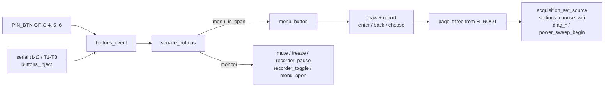

# Buttons and menu

Three buttons (B1, B2, B3) are debounced into press events and drive either the monitor shortcuts or the on-device menu. **The menu only replaces the screen content and the meaning of the buttons; acquisition, detection, inference, recording, MQTT, NeoPixel and beat beeps keep running while it is open.**



## How it works

### Button events

`buttons_event` (`buttons.cpp:24`, `buttons_event`) polls the three buttons (active low, `INPUT_PULLUP`) and returns one event per call, or `BUTTON_NONE`.

| Event | When |
|---|---|
| `BUTTON_PRESS` | The input went low and stayed past the debounce time |
| `BUTTON_LONG` | Still held when `BUTTON_LONG_MS` (800 ms, `buttons.h:14`) is reached; the action happens at that moment, without waiting for release |
| `BUTTON_SHORT` | Released before 800 ms; the action happens on release |
| `BUTTON_RELEASE` | Release after a long press; no action |

`DEBOUNCE_MS` (`buttons.cpp:7`) is 50 ms. `buttons_pressed` reports the live state for the on-screen captions. `buttons_inject` (`buttons.cpp:17`, `buttons_inject`) queues up to 8 synthetic events that `buttons_event` returns before it reads the pins; serial `t1`-`t3` (short) and `T1`-`T3` (long) use it, so menu navigation can be tested without touching the buttons (see [serial-commands](serial-commands.md)).

`service_buttons` (`main.cpp:23`, `service_buttons`) drains the events each loop pass. Every press clicks the buzzer for `CLICK_MS` (20 ms) and every long press beeps `BEEP_LONG_MS` (60 ms). If the menu is open the event goes to `menu_button` (`main.cpp:31`) and nothing else; otherwise the monitor map below applies.

### Button map

| Context | B1 | B2 | B3 |
|---|---|---|---|
| Monitor, short | Mute or unmute the beat beeps | Freeze or resume the waveform and beeps | Not recording: start a recording (same as serial `r`, only from the sensor source). Recording: pause. Paused: resume (same as `j`) |
| Monitor, long | none | Open the menu; refused during a recording session with the "TERKUNCI" (locked) message | Recording or paused: stop and save to `/rekam/NNN.csv` (same as `r`). Not recording: none |
| Menu, short | Down (wraps) | Back one level; at the root, close the menu | Up (wraps) |
| Menu, long | Straight to the monitor | Choose or enter | Straight to the monitor |

On text pages (status, info, test result, power result) B1 and B3 short do nothing and B2 short goes back. The bottom two lines of every menu screen show the hints for the current page (`draw`, `menu.cpp:276`). The monitor is redrawn when the menu closes; the waveform is not drawn while the menu is open. The recording lock and its beeps are described in [recording](recording.md); the captions and beeps in [display-and-buzzer](display-and-buzzer.md).

### Menu model

`page_t` (`menu.cpp:33`, `page_t`) is one of three kinds, built with the macros `LIST`, `DYNAMIC` and `TEXT`:

| Kind | Content |
|---|---|
| `LIST` | Static array of `item_t`: label, optional child page, optional action, optional value text (`*`, `ON`/`OFF`, a name) |
| `DYNAMIC` | Rows produced at draw time (`n_dyn`, `text_dyn`); choosing a row calls `choose_dyn` and goes back |
| `TEXT` | Up to `DISPLAY_ROWS` lines filled by a function; refreshed once per second by `menu_service` |

The open pages form a stack of at most `DEPTH_MAX` (4, `menu.cpp:258`) entries with a selected row and a scroll offset per level. `enter`, `back`, `choose` and `close_menu` (`menu.cpp:319`, `menu.cpp:343`, `menu.cpp:351`, `menu.cpp:336`) manipulate it. Every navigation step is also printed to serial so the menu can be followed headless.

`menu_open` (`menu.cpp:328`, `menu_open`) refuses while a recording session is open (`recorder_reject("menu")`), otherwise switches the display out of monitor mode and enters `H_ROOT` (`menu.cpp:256`). `begin_sweep` closes the menu when a power sweep starts, and `menu_service` (`menu.cpp:386`, `menu_service`) opens the power result page when a sweep ends.

### Menu tree

Labels are Indonesian strings in the code; glosses are given once.

```
MENU
├─ Sumber sinyal ── Sensor (ADC) | REPLAY 208 | Replay rekaman ─► list of /rekam/NNN.csv
├─ Kalibrasi ────── Mulai ulang | Lewati (bench) ON/OFF | Status
├─ Tes perangkat ── Buzzer | Layar (pola warna) | ADC & lead-off | INA219 | Tombol (10 s)
├─ Ukur daya ────── Mulai tangga p0-p5 | Hasil terakhir
├─ Jaringan ─────── WiFi aktif ON/OFF | WiFi ─► list | Broker ─► list | Status
└─ Info
```

A `*` at the right marks the active choice and `>` marks a submenu.

| Page | Content and action |
|---|---|
| "Sumber sinyal" (signal source, `menu.cpp:75`, `H_SOURCE`) | "Sensor (ADC)": the AD8232 through the electrodes. "REPLAY 208": the reference record replayed in a loop (same as serial `y`). "Replay rekaman" (replay recording): lists recordings with their duration; choosing one loads it and returns (`recordings_choose`, `menu.cpp:60`). Each choice goes through `acquisition_set_source`, which starts a new calibration session and zeroes the beat count |
| "Kalibrasi" (calibration, `menu.cpp:111`, `H_CALIBRATION`) | "Mulai ulang" (restart): new calibration session and classifier counts from zero. "Lewati (bench)" (skip): toggles the gate skip like serial `k`. "Status": phase, contact time against `WARMUP_MS`, quiet RR time against `RR_QUIET_MS`, swing and 50 Hz hum against `THRESHOLD_SWING` and `THRESHOLD_HUM`, skip and replay flags, missed samples (`calibration_status`, `menu.cpp:90`) |
| "Tes perangkat" (device test, `menu.cpp:153`, `H_TEST`) | Each entry runs one `diag_*` function through `test_run` (`menu.cpp:115`, `test_run`), which pauses the acquisition timer, then opens the result page with pass or fail ("LULUS"/"GAGAL") and the summary. "Tombol (10 s)" (buttons) waits 10 s for B1, B2 and B3 |
| "Ukur daya" (measure power, `menu.cpp:181`, `H_POWER_MENU`) | "Mulai tangga p0-p5" (start ladder): `power_sweep_begin`. "Hasil terakhir" (last result): table of mode, current and power (`power_fill`, `menu.cpp:155`) |
| "Jaringan" (network, `menu.cpp:228`, `H_NETWORK`) | "WiFi aktif": toggles the radio like serial `m`. "WiFi" and "Broker": lists from `wifi_secrets.h`; choosing an entry is the same as serial `w<n>` or `b<n>`. "Status": MQTT state, SSID, IP, RSSI, broker host and port, sent count and backlog (`net_status`, `menu.cpp:210`) |
| "Info" (`menu.cpp:246`, `H_INFO`) | IP and RSSI, active broker, INA219 voltage and current, uptime, `GIT_VERSION` and build date and time (`info_fill`, `menu.cpp:230`) |

The source, WiFi on/off, WiFi and broker choices are stored in NVS and restored at boot ([network-settings](network-settings.md)). The device tests are described in [diagnostics](diagnostics.md).

## Interfaces

| Interface | Details |
|---|---|
| `buttons_event`, `buttons_pressed`, `buttons_inject` | Event source, live state, test injection (`buttons.h`). |
| `menu_is_open`, `menu_open`, `menu_button`, `menu_service` | Called from `main.cpp`; `menu_service` also drives the 1 s refresh. |
| Serial `t1`-`t3`, `T1`-`T3` (`serial_cmd.cpp:129`, `serial_cmd_service`) | Inject short and long presses. |

## Limits and out of scope

- The menu cannot be opened during a recording session; a single check in `recorder_reject` enforces the same lock for the serial commands.
- Page content for tests, power and network is produced by the modules documented in [diagnostics](diagnostics.md), [power-measurement](power-measurement.md) and [mqtt-telemetry](mqtt-telemetry.md).

**Code:** `firmware/include/buttons.h` · `firmware/src/buttons.cpp` · `firmware/include/menu.h` · `firmware/src/menu.cpp` · `firmware/src/main.cpp`
