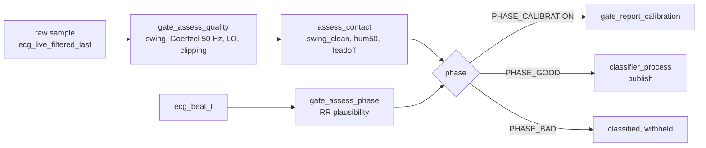

# Calibration gate

The gate measures signal quality once per second and decides which phase the device is in: calibration, good or bad. **No beat is classified during calibration, and only beats in the good phase are published.**

## How it works

### Quality measure, once per second

`gate_assess_quality` (`gate.cpp:114`, `gate_assess_quality`) is called for every sample in `loop()`. It accumulates minimum and maximum of the filtered value (`ecg_live_filtered_last`) and of the raw ADC counts, counts samples where `PIN_LOP` or `PIN_LON` reads HIGH, and runs a Goertzel filter at `FREQUENCY_MAINS_HZ` = 50. After `ECG_FS` samples it publishes `gate_quality_t` (`gate.h:15`, `gate_quality_t`):

| Field | Definition |
|---|---|
| `swing` | max minus min of the filtered signal over the second |
| `hum50` | peak-to-peak amplitude of the 50 Hz component from the Goertzel state |
| `swing_clean` | `swing` minus `GAIN_50HZ` (0.342) times the 50 Hz peak-to-peak, floored at 0 |
| `clipping` | raw maximum at or above `ADC_UPPER` (4090) or minimum at or below `ADC_LOWER` (5) |
| `leadoff` | any lead-off pin HIGH during the second |
| `contact` | result of `assess_contact` |

Swing is measured on the bandpassed signal with the mains contribution subtracted, so strong 50 Hz hum cannot pass as signal. Clipping is judged on the raw ADC because a signal clipped at the rail has lost information before any filter. Clipping is reported but does not enter the contact decision.

### Contact and phase

`assess_contact` (`gate.cpp:83`, `assess_contact`) sets `contact` when the lead-off pins are quiet (or the source is a replay), `swing_clean >= THRESHOLD_SWING` (60) and `hum50 <= THRESHOLD_HUM` (500) (`gate.h:9-10`). The time contact has held is `gate_contact_ms`. Outside calibration the phase follows `contact` every second: `PHASE_GOOD` when true, `PHASE_BAD` when false (a state change prints one transition line).

`gate_assess_phase` (`:60`, `gate_assess_phase`) runs for each beat. A beat is plausible when RR is between `RR_MIN_S` (0.3 s) and `RR_MAX_S` (1.5 s) and the RR difference `|rr[2]|` is at most `DRR_MAX_S` (0.2 s) (`:64`); an implausible beat restarts the quiet timer `t_rr_violation`. In `PHASE_CALIBRATION` the phase becomes `PHASE_GOOD`, with a 600 ms beep, when contact exists and any of these holds:

- contact has lasted `WARMUP_MS` (60 s) and RR has been quiet for `RR_QUIET_MS` (30 s) (`gate.h:12-13`);
- the source is a replay (`acquisition_replay`), which skips the gate;
- calibration is skipped (`gate_skip`).

The RR criteria only gate entry to the monitoring phase. They are not a per-beat filter, because ventricular beats arrive with a large RR difference by nature.

### Session start

`gate_begin_session` (`:37`, `gate_begin_session`) plays the 600 ms calibration beep, calls `ecg_live_reset`, records `t_session_ms` (the time base of published beats), sets `PHASE_CALIBRATION`, resets contact and clears the beep schedule. It runs at boot, on every source change (`acquisition_set_source`), on "Mulai ulang" and when the skip flag is turned off. `gate_set_skip` (`:48`, `gate_set_skip`) is refused while a recording runs.

While calibrating, `gate_report_calibration` (`:97`, `gate_report_calibration`) prints one status line every 5 seconds with the RR quiet time, swing, hum, lead-off, contact time and the skip and replay flags. `gate_phase_name` returns `calibrating`, `good` or `poor` for the transition logs.

## Interfaces

| Interface | Details |
|---|---|
| Menu "Kalibrasi" (calibration), `menu.cpp:111`, `H_CALIBRATION` | "Mulai ulang" (restart, `calibration_restart`, `:78`), "Lewati (bench)" (skip, `calibration_skip`, `:84`), "Status" page with phase, contact, RR quiet, swing, hum and lost samples (`calibration_status`, `:90`). |
| Serial `k` (`serial_cmd.cpp:106`) | Toggles the skip flag. |
| Serial `q` (`serial_cmd.cpp:113`) | Toggles the per-second quality report line (`gate_set_report`). |
| NeoPixel | Blue in calibration, orange in the bad phase, green in the good phase (`display.cpp:161-163`). |

The [display and buzzer](./display-and-buzzer.md) page covers the beep and HR rules that use `swing_clean`; [Classification](./classification.md) covers the publish rule; the [acquisition walkthrough](../../model/docs/acquisition-walkthrough.md) explains the measurements behind the thresholds.

## Limits and out of scope

- Thresholds are compile-time constants, not user settings.
- The gate judges contact and RR plausibility, not rhythm class.

**Code:** `firmware/include/gate.h` · `firmware/src/gate.cpp` · callers `firmware/src/main.cpp` · `firmware/src/menu.cpp` · `firmware/src/serial_cmd.cpp` · `firmware/src/acquisition.cpp`
