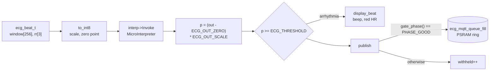

# Classification

For every beat that leaves the signal pipeline, the classifier runs the INT8 TFLite Micro model on the beat window and its RR features and returns one probability of arrhythmia. **A beat is published to MQTT only in the good phase of the calibration gate.**

## How it works

`loop()` calls `classifier_process` (`classifier.cpp:98`, `classifier_process`) for each beat when the gate phase is not calibration and the classification stage is enabled (see [Architecture](./architecture.md)). It runs `classifier` (`:64`, `classifier`), compares the probability with `ECG_THRESHOLD` (0.8, `model_int8.h:8`, `ECG_THRESHOLD`, calibrated on the validation split in the model pipeline), updates the counters, prints one serial line per beat and calls `publish` (`:74`, `publish`). It returns whether the beat is an arrhythmia.

### The model and its generated header

`firmware/include/model_int8.h` is generated by `model/scripts/export_model_h.py` and holds the quantized network as a C array (`model_int8_tflite_len` = 23.488 bytes, `model_int8.h:17`), the decision threshold and the scale and zero point of the two inputs and the output. The network has two inputs, the 256-sample morphology window and the 3 RR features, and one sigmoid output. It is never edited by hand.

### Setup

`classifier_begin` (`classifier.cpp:31`, `classifier_begin`) builds the interpreter once:

- The op resolver registers exactly the 8 ops of the deployed model (`MicroMutableOpResolver<8>`, `:34`): Conv2D, DepthwiseConv2D, MaxPool2D, Concatenation, Logistic, Add, Reshape, ExpandDims. `AllOpsResolver` is not used because it links every op into flash.
- The tensor arena is a static `ARENA_N` = 24 KB array (`:19`, `ARENA_N`) in internal RAM, not PSRAM, because inference touches it thousands of times per beat. `classifier_arena` (`:28`, `classifier_arena`) reports the bytes actually used.
- The `ErrorReporter` constructor argument is passed only when the TFLM version provides `micro_error_reporter.h` (`TFLM_HAS_ERROR_REPORTER`, `:11`).
- The input order in the `.tflite` is not guaranteed to match Keras, so the RR tensor is the input with fewer bytes and the morphology tensor the other (`:50-52`).
- If `AllocateTensors` fails, the firmware prints a fatal message and blinks the NeoPixel red forever (`:45-47`).

### Inference

`to_int8` (`:56`, `to_int8`) quantizes a float with the stored scale and zero point and clamps to -128..127. The output byte is dequantized as `(out - ECG_OUT_ZERO) * ECG_OUT_SCALE`, which is the probability because the last op is a sigmoid (`AddLogistic`).

### Publishing

`publish` fills one `ecg_mqtt_beat_t` and queues it with `ecg_mqtt_queue_fill` (`:95`), unless MQTT is inactive (nothing happens), the gate phase is not `PHASE_GOOD` or `signal_lost` is set (`withheld` increments, `:77-78`). The record carries:

| Field | Source |
|---|---|
| `ms` | session start from `gate_t_session_ms` plus `r_abs` converted to milliseconds |
| `rr_ms`, `bpm` | from `rr[0]`, `bpm` = 60 / RR |
| `label` | 1 for arrhythmia, else 0 |
| `confidence` | `p` for arrhythmia, else `1 - p` |
| `quality_ok` | always 1 (only good-phase beats are published) |
| `snippet` | `ECG_SNIPPET_N` = 8 points picked evenly from the window, scaled by 1000 to `int16_t` |

The snippet is sampled evenly across the 256-sample window, not centered on R. The queue latency (`millis() - ms`) feeds `classifier_stats_t` (`classifier.h:14`, `classifier_stats_t`: `total`, `arrhythmia`, `withheld`, `latency_sum`, `latency_n`, `latency_max`); `classifier_reset` (`classifier.cpp:27`, `classifier_reset`) zeroes it on every new calibration session. See [MQTT telemetry](./mqtt-telemetry.md) for how the ring is sent, and [Serial commands](./serial-commands.md) for the statistics output.

## Interfaces

| Interface | Details |
|---|---|
| `classifier_process(beat)` | Classifies and publishes one beat; returns true for arrhythmia. |
| `classifier_threshold()` (`:29`) | Decision threshold shown in the boot banner. |
| `classifier_stats()` (`:26`) | Counters read by the serial status command. |
| `pio test -e esp32-s3 -f test_inference` | INT8 inference equals the PC interpreter on the golden input, latency, arena size. |

The model, quantization and threshold are explained in the [model walkthrough](../../model/docs/model-walkthrough.md), the [quantization walkthrough](../../model/docs/quantize-walkthrough.md) and the [firmware walkthrough](../../model/docs/firmware-walkthrough.md); see [Model pipeline](./model-pipeline.md) for how the header is produced.

## Limits and out of scope

- Beats in the bad phase are classified and shown but never published; beats in the calibration phase are not classified at all.

**Code:** `firmware/include/classifier.h` · `firmware/include/model_int8.h` (GENERATED) · `firmware/src/classifier.cpp` · caller `firmware/src/main.cpp` · generator `model/scripts/export_model_h.py` · tests `firmware/test/test_inference/`
