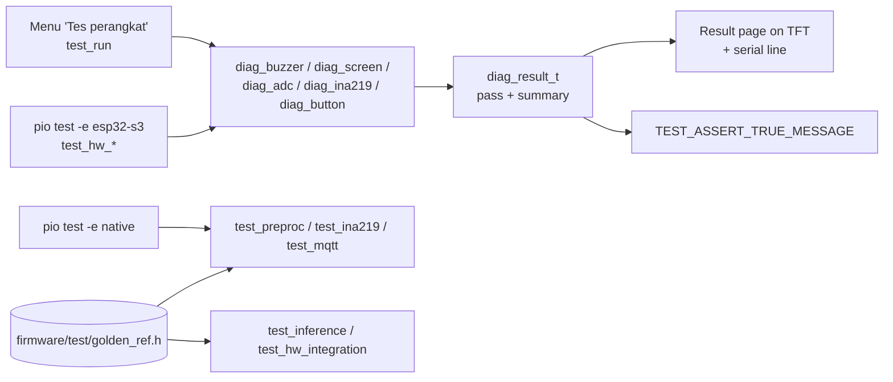

# Diagnostics and tests

One set of device self-tests (`diag_*` in `diagnostics.cpp`) serves both the on-device menu and the PlatformIO hardware suites, and a second set of Unity suites checks the signal path against golden data. **A `diag_*` function holds the only copy of each hardware check: the menu and the `test_hw_*` suites call it, so a check never exists twice.**

## How it works

**Device self-tests.** Each function returns `diag_result_t` (`pass`, 64-character `summary`) and prints the verdict on serial. Pass criteria are limited to what can be measured without a person and without electrodes; what a human must judge is printed as an instruction.

| Function | Checks | Judged by a person |
|---|---|---|
| `diag_buzzer` (`diagnostics.cpp:43`) | Buzzer pin is still routed to LEDC channel `CHANNEL_BUZZ` (a later SPI init can steal it), output is inverted and enabled, it never reads low when idle, about 50 percent (tolerance 15 points) while sounding, and returns high after the three beeps | Three short beeps |
| `diag_screen` (`diagnostics.cpp:81`) | Display reports `TFT_W` x `TFT_H`; a full-screen fill takes more than `FILL_MIN_US` (5 ms) and less than 500 ms, which proves SPI transfers | Four color bands and the text "TFT OK" for 2 s |
| `diag_adc` (`diagnostics.cpp:106`) | 100 raw ADC reads on `CHANNEL_ECG` all within 0 to 4095, then one second of readings (`READ_ADC_ONE_SECOND` = 360); prints min, max, swing and the lead-off pins | None; passing does not depend on electrodes |
| `diag_ina219` (`diagnostics.cpp:124`) | The INA219 answers at `INA219_ADDRESS` and returns registers; bus voltage in 0 to `V_BUS_MAX` (32 V) and current within `I_SCALE_FULL_MA`. Bus voltage under `V_BUS_SUPPLY_MIN` (1 V) passes and is reported as not being the supply path | None |
| `diag_button` (`diagnostics.cpp:148`) | B1, B2, B3 each pressed once within `limit_ms`, with a 50 ms debounce; each press gives a 20 ms buzzer click | Pressing the buttons |

**Menu.** "Tes perangkat" (device tests) in `menu.cpp` (`H_TEST`, `menu.cpp:153`) runs one function through `test_run` (`menu.cpp:115`): acquisition is paused (`acquisition_timer(false)`), the function runs, acquisition resumes according to the power mode, pending button events are drained, and a result page shows the verdict and `summary`. Entries: "Buzzer", "Layar" (screen), "ADC & lead-off", "INA219", "Tombol (10 s)" (buttons, 10 s limit via `button_10s`).

**Hardware suites (`pio test -e esp32-s3`, board required).** `test_filter` (`platformio.ini:16`) of the `esp32-s3` environment is `test_preproc, test_inference, test_hw_*`. Each suite owns its `setup()` and `loop()` because `main.cpp` is excluded under `PIO_UNIT_TESTING`.

| Suite | Tests | What passes |
|---|---|---|
| `test_hw_buzzer` | 1 | `diag_buzzer` passes |
| `test_hw_tft` | 2 | Board init under 2000 ms; `diag_screen` passes |
| `test_hw_adc` | 2 | `diag_adc` passes; a 360 Hz timer yields 2 x `ECG_FS` samples in 2 s within 4 |
| `test_hw_ina219` | 1 | `diag_ina219` passes three times in a row. The INA219 module is not fitted on the board yet, so this suite fails with `INA219 0x40 tidak menjawab (SDA17 SCL18)` until it is |
| `test_hw_buttons` | 2 | B1 to B3 read high when idle; `diag_button(300)` returns within 50 ms of 300 ms and does not pass. No button may be pressed during this suite |
| `test_hw_integration` | 5 | Replays `golden_raw` through the 360 Hz ISR, queue, `ecg_live`, heart rate and TFLM with TFT, INA219 and buzzer active: zero missed samples, at least `ROUNDS` x `GOLDEN_N_BEAT` - 4 beats, heart rate within 3 bpm of the annotated RR, and every label equal to the PC label |
| `test_inference` | 5 | INT8 model loads with golden tensor sizes; probabilities within `GOLDEN_TOL_PROB` of the PC interpreter and identical labels; golden diagnostic input; lifecycle; latency and arena within bounds |
| `test_preproc` | 11 | See native suites; also runs on the board |

ADC, lead-off and INA219 readings depend on electrodes and supply, so they are printed and not made pass criteria. Run one suite with `-f test_hw_buzzer`, and add `-v` to see printed readings and instructions.

**Native suites (`pio test -e native`, PC only).** The `native` environment builds `ecg_pipeline.cpp`, `ecg_live.cpp`, `ina219.cpp` and `ecg_mqtt.cpp` with `-I include -std=c++17`; `test_filter` (`platformio.ini:24`) is `test_preproc, test_ina219, test_mqtt`.

| Suite | Tests | Covers |
|---|---|---|
| `test_preproc` | 11 | Bandpass (whole and streaming), window z-score and its properties, RR features and early-beat rejection, whole pipeline, R detection and alignment, live beat emission and the first two dropped beats, all against `golden_ref.h` |
| `test_ina219` | 6 | Shunt register to mA (positive, reversed polarity, zero, other shunt value) and bus register to volts (ignores status bits) |
| `test_mqtt` | 6 | Single and batch JSON payload, short buffer returns 0, ring FIFO with peek and drop, oldest dropped when full, attach capacity |

`golden_ref.h` is a regression reference generated by `model/scripts/export_golden.py` (see [model-pipeline.md](model-pipeline.md)); it guarantees C and Python compute the same thing, not that the parameters are optimal. After changing a parameter, regenerate it and rerun `pio test -e native`.

## Interfaces

| Interface | Details |
|---|---|
| `pio test -e native` | 23 tests on the PC, no board |
| `pio test -e esp32-s3` | 29 tests on the board, `-f <suite>` for one, `-v` for output |
| Menu "Tes perangkat" | `H_TEST` (`menu.cpp:153`), `test_run` (`menu.cpp:115`) |
| Serial `t1` to `t3`, `T1` to `T3` (`serial_cmd.cpp:129`, `t`/`T` branch) | Inject short or long button presses so the menu can be driven without touching the board |

## Limits and out of scope

- Buzzer sound and screen content are judged by a person; only their electrical and timing side is asserted.
- `test_hw_*` suites need the board attached and no other serial monitor open.

**Code:** `firmware/include/diagnostics.h` · `firmware/src/diagnostics.cpp` · `firmware/src/menu.cpp` · `firmware/platformio.ini` · tests `firmware/test/test_hw_buzzer/` · `firmware/test/test_hw_tft/` · `firmware/test/test_hw_adc/` · `firmware/test/test_hw_ina219/` · `firmware/test/test_hw_buttons/` · `firmware/test/test_hw_integration/` · `firmware/test/test_inference/` · `firmware/test/test_preproc/` · `firmware/test/test_ina219/` · `firmware/test/test_mqtt/`
