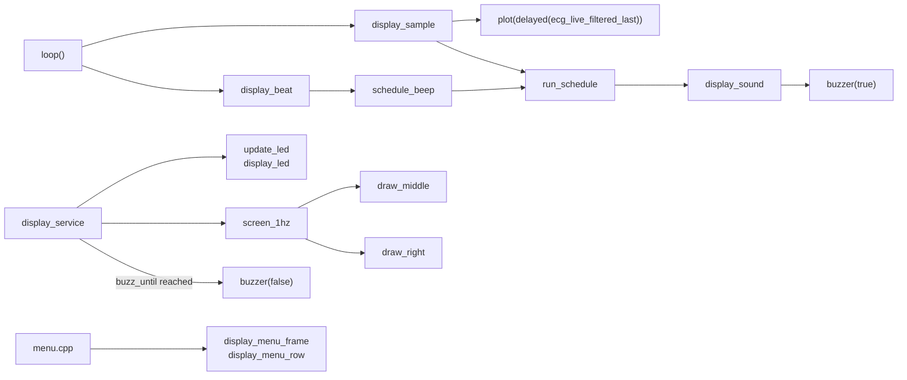

# Display and buzzer

The TFT monitor, the menu frame, the NeoPixel and the buzzer are all driven from `display.cpp`. **The beep for a beat is scheduled by sample count, not by time, so it lands on the R peak that the delayed waveform draws on screen.**

## How it works

`main.cpp` calls `display_sample` for every sample taken from the acquisition queue and `display_beat` for every detected beat (both only while the power stage allows the UI, `power_stage(4)`). `display_service` runs once per loop pass and does the time-driven work.

### Waveform

`display_sample` (`display.cpp:107`, `display_sample`) first runs the beep schedule, then feeds the last filtered sample into `plot` (`display.cpp:80`, `plot`) through `delayed` (`display.cpp:72`, `delayed`), a ring of `BEEP_DELAY` samples. Every `DECIMATION` (3) samples one column is drawn: the column area is cleared and a vertical green line joins the previous and the new y. After `TFT_W` columns the x position wraps and the vertical scale is refitted from the minimum and maximum seen during the sweep (span at least 50 counts, 10 % margin on both sides). While frozen (`display_set_freeze`) or while the menu is open (`monitor` false) nothing is drawn; the scale statistics still update.

### Beep timing

| Constant | Value | Meaning |
|---|---|---|
| `BEEP_DELAY` (`display.cpp:43`) | `ECG_LIVE_EVERY + ECG_WIN_POST + ECG_FS / 10` = 524 samples | Detection latency plus a margin; it is both the plot delay and the beep delay, so the beep and the drawn R peak coincide |
| `BEEP_MS`, `BEEP_ARRHYTHMIA_MS` (`display.cpp:18`) | 50 ms, 250 ms | Normal beat and arrhythmia beat |
| `SCHEDULE_N` (`display.cpp:44`) | 8 | Pending beeps; a beat arriving with the schedule full is dropped |

`display_beat` (`display.cpp:113`, `display_beat`) ignores beats while the cleaned swing is below `THRESHOLD_SWING`, updates the heart rate shown (`60 / rr[0]`, red when the beat is an arrhythmia, "--" after `HR_STALE_MS` of 3 s without a beat), and calls `schedule_beep` (`display.cpp:50`, `schedule_beep`) only outside the calibration phase and when not muted. `run_schedule` (`display.cpp:58`, `run_schedule`) pops entries whose sample number has been reached and calls `display_sound` unless the display is frozen. `display_clear_schedule` empties the queue; the gate calls it when a session restarts.

### Buzzer

`display_sound` (`display.cpp:37`, `display_sound`) switches the buzzer on and records `buzz_until`; `display_service` switches it off once `millis()` passes it. The buzzer is a passive module on `PIN_BUZZ` driven by LEDC at `TONE_HZ` with inverted output (`board.cpp:12`, `attach_buzzer`), so the idle level is high. Other beeps use the same call:

| Caller | Duration | Event |
|---|---|---|
| `service_buttons` (`main.cpp:23`) | `CLICK_MS` 20 ms, `BEEP_LONG_MS` 60 ms | Press click, long-press confirmation |
| `display_message` (`display.cpp:172`) | `BEEP_REJECT_MS` 150 ms | Rejection |
| `close_write` (`recorder.cpp:149`) | `BEEP_SAVE_MS` 400 ms | Recording file written |
| `BEEP_CALIBRATION_MS` (`gate.cpp:15`) | 600 ms | Calibration phase change |

### NeoPixel

`update_led` (`display.cpp:153`, `update_led`) refreshes the NeoPixel on `PIN_LED` every `PERIOD_LED_MS` (250 ms): off when the power stage is below 4, blue during `PHASE_CALIBRATION`, orange during `PHASE_BAD`, green otherwise. `classifier_begin` blinks it red forever if the model fails to initialise.

### Monitor screen

`screen_1hz` (`display.cpp:276`, `screen_1hz`) redraws once per second, only in monitor mode: heart rate on the left, `draw_middle` in the centre, `draw_right` on the right, and the three button captions at the bottom.

- **Centre** (`display.cpp:181`, `draw_middle`) alternates every 3 s. One phase shows the INA219 current, voltage and power in cyan, or `INA --` in red with the I2C pins when the sensor does not answer. The other shows the clock `HH:MM:SS` and date once the clock is above 2020 (NTP synced, time zone WIB), otherwise the uptime with "up (belum NTP)" (up, no NTP yet).
- **Right** (`display.cpp:228`, `draw_right`) shows one status, chosen by priority: a pending `display_message`, `HILANG` (lost, with the missed-sample count) while recording with missed samples, `RECmm:ss` (REC) while recording with "bagian k" (part k) from the second part on, `JEDA` (paused), `SIMPAN..` (saving), `SIMPAN` (saved) with the file name for 3 s, `RP#NNN` for a replayed recording, `RP 208` for the reference replay. It redraws only when the text, sub-text or colour changed.
- **Captions** (`display.cpp:122`, `display_draw_button`): "B1 BUNYI" (B1 sound) or "B1 BISU" (mute), "B2 JALAN" (B2 run) or "B2 BEKU" (freeze), and for B3 "B3 REC", "B3 JEDA" (pause), "B3 LANJUT" (resume) with "tahan=SIMPAN" (hold = save). A pressed button is drawn black on yellow.

`display_message(large, small)` (`display.cpp:172`) takes at most 8 and 16 characters, shows them in the right area for `MESSAGE_MS` (2 s) and sounds the reject beep. Callers: `menu_open` ("TERKUNCI", locked), `recorder_toggle` ("TOLAK" rejected, "PENUH" full, "TUNGGU" wait), `recorder_service` ("RUANG PENUH" storage full, "BATAS SESI" session limit) and `open_part` ("GAGAL SIMPAN", save failed).

### Menu screen

`display_menu_frame` (`display.cpp:319`, `display_menu_frame`) clears the screen, draws the title bar and the two hint lines. `display_menu_row` (`display.cpp:337`, `display_menu_row`) draws one of `DISPLAY_ROWS` (6) rows of `DISPLAY_COLUMNS` (26) characters, highlighted black on yellow, and skips the redraw when the text and highlight are unchanged. `display_set_monitor(false)` stops monitor drawing when the menu opens; `display_set_monitor(true)` (`display.cpp:303`) clears the screen and forces a full monitor redraw when it closes. See [buttons-and-menu](buttons-and-menu.md) for the pages themselves.

## Interfaces

| Interface | Details |
|---|---|
| `display_begin` | Draws the separator line and the three captions; called from `setup`. |
| `display_sample`, `display_beat` | Per-sample plot and beep schedule; per-beat heart rate and beep scheduling. |
| `display_service` (`display.cpp:355`) | LED refresh, 1 Hz redraw, buzzer switch-off. |
| `display_sound(ms)`, `display_led(r, g, b)` | Buzzer and NeoPixel primitives used by the gate, recorder and `service_buttons`. |
| `display_mute`, `display_freeze` and setters | State toggled by B1 and B2 in the monitor (serial `s` prints both). |
| `display_set_monitor`, `display_menu_frame`, `display_menu_row` | Used by `menu.cpp`. |

## Limits and out of scope

- The schedule holds 8 beeps; overflow drops the beep, not the beat.
- The pin map and the circuit of the display, buzzer and LED are in `hardware/mainboard/README.md`.
- Button handling is in [buttons-and-menu](buttons-and-menu.md); the recording state shown at the top right is in [recording](recording.md).

**Code:** `firmware/include/display.h` · `firmware/src/display.cpp` · `firmware/src/board.cpp` · `firmware/include/board.h`
