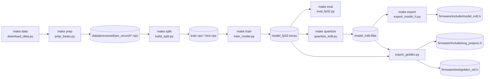

# Model pipeline

The Python pipeline in `model/` turns MIT-BIH recordings into a trained, quantized INT8 classifier and writes the C headers the firmware compiles. **The firmware headers are generated and never edited by hand: `model_int8.h`, `ecg_preproc.h` and `golden_ref.h` come from `model/` so C and Python share one set of constants.**

## How it works

All commands run from `model/`. The `Makefile` (`model/Makefile:1`, `PY`) uses `model/.venv/bin/python` when it exists, otherwise `python`; `make help` prints every target with its description. Constants (sampling rate, bandpass, window, label map, threshold) live in `config.py`; ablation knobs are read from the environment (`PA_WIN_PRE`, `PA_WIN_POST`, `PA_HOS`, `PA_QRSW`, `PA_RR_RATIO`), so an experiment never edits the final values.

| Target | Script | Output |
|---|---|---|
| `data` | `scripts/download_data.py` | MIT-BIH into `data/raw/mitdb` (run once) |
| `data-all` | `scripts/download_data.py --all` | adds SVDB and INCART under `data/raw/<db>/` |
| `check` | `scripts/check_dataset.py` | checks `.hea`, `.dat`, `.atr` completeness |
| `plot0`, `plot1`, `plot1seg` | `plot_phase0.py`, `plot_phase1.py`, `plot_phase1_segment.py` | verification plots for one record (`REC=<record>`, default 100) |
| `prep` | `scripts/prep_beats.py` | beats, labels and RR features per record in `data/processed/per_record/` (rerun when `config.py` or the preprocessing and RR modules change, tracked by a `.stamp` file) |
| `split` | `scripts/build_split.py` | `train.npz` (DS1) and `test.npz` (DS2), split per patient |
| `split-multi` | `scripts/build_split.py --combined` | `train_multi.npz`, `test_ds2.npz`, `test_<db>.npz`; leaves `train.npz` and `test.npz` untouched |
| `train` (`model/Makefile:33`) | `scripts/train_model.py` | `artifacts/model_fp32.keras` and the training plot |
| `eval` | `scripts/eval_fp32.py` | float32 metrics and confusion matrix on DS2 in `artifacts/metrics/` (the threshold is taken as is from `config.THRESHOLD`) |
| `quantize` | `scripts/quantize_int8.py` | `artifacts/model_int8.tflite`, re-evaluation with the same procedure as `eval`, and the delta table |
| `export` (`model/Makefile:39`) | `../scripts/export_artifacts.sh` | runs `export_model_h.py` to write `firmware/include/model_int8.h`; with `--laporan` it also copies finished figures into the thesis folder |
| `poc` | `scripts/check_poc.py` | verifies the eight PRD definition-of-done items mechanically, nonzero exit if any fails |
| `test` | `python -m pytest tests/ -q` | numeric DoD assertions per module |
| `pull` | `scripts/pull_recording.py` | recording from the board into `data/recordings/` (see [recording.md](recording.md)) |
| `pull-power` (`model/Makefile:44`) | `scripts/pull_power.py` | power sweep result into `artifacts/metrics/daya/` (see [power-measurement.md](power-measurement.md)) |
| `analyze`, `plot` | `analyze_recording.py`, `plot_recording.py` | numeric quality grade and the best-60-seconds ECG plot of a recording (`FILE=`) |
| `broker-info` | `scripts/broker_info.py` | laptop WiFi SSID, LAN IPv4, ports 1883 and 8080, and a suggested broker entry (see [network-settings.md](network-settings.md)) |
| `clean` | `rm -rf` | deletes `data/processed` and generated `artifacts/metrics/*.png` and `*.csv`; raw data and the trained model are kept |

**Pure modules (`model/src/`).** Functions take inputs and return outputs without side effects:

| Module | Role |
|---|---|
| `io_mitdb.py` | `load_record` (`io_mitdb.py:19`), `select_lead`: reads a record and keeps the MLII lead and beat annotations |
| `preprocessing.py` | causal bandpass (`design_bandpass_sos`, `apply_bandpass`), Pan-Tompkins detector (`pan_tompkins_detect`), `segment_beats`, `zscore_per_window`, `jitter_r`, `resample_to_fs`, `align_r` |
| `features_rr.py` | AAMI to binary label (`to_aami_class`, `to_binary_label`), RR features (`compute_rr_features`, `assemble_rhythm_features`), optional HOS and QRS-width features |
| `dataset.py` | per-patient split (`build_split`, `split_train_val`, `build_split_multi`) with `assert_split_valid` against identity leakage |
| `model.py` | `build_hybrid_model` (`model.py:10`, morphology CNN plus rhythm Dense) and `build_deploy_model` |
| `train.py` | `make_class_weights`, `compile_model`, `train` |
| `evaluate.py` | confusion counts, metrics, threshold sweep, per-record metrics, ROC AUC, average precision, MCC, detector pairing |
| `quantize.py` | `representative_dataset_gen`, `quantize_int8` (`quantize.py:36`), `assert_rhythm_scale_sane`, `predict_tflite` |

**Generated firmware headers.**

| Header | Generator | Content |
|---|---|---|
| `firmware/include/model_int8.h` | `export_model_h.py` (`main` at `export_model_h.py:30`, `quant_params` at `export_model_h.py:15`) | the `.tflite` bytes as `model_int8_tflite`, plus `ECG_THRESHOLD` and the scale and zero point of the morphology input, rhythm input and output tensors, read from the interpreter (an `xxd -i` dump would miss them) |
| `firmware/include/ecg_preproc.h` | `export_golden.py` (`main` at `export_golden.py:48`) | `ECG_FS`, window sizes, RR feature counts and the Pan-Tompkins constants the C port needs |
| `firmware/test/golden_ref.h` | `export_golden.py` (`main`) | raw and filtered excerpt, R positions, labels, windows, RR features, int8 probabilities and tolerances (`GOLDEN_TOL_PROB`), used by the native and board tests |

`golden_ref.h` is a regression reference: it guarantees C and Python compute the same thing, not that a parameter is optimal. To change a parameter, edit the default in `config.py`, run `python scripts/export_golden.py`, then `pio test -e native` (see [diagnostics.md](diagnostics.md)). Finished figures go from `model/artifacts/metrics/` to the report through `export_artifacts.sh --laporan`, never by hand-copying.

## Walkthroughs

Per-stage explanations with the math, rejected alternatives and measured numbers live in `model/docs/`, indexed by `model/docs/README.md`:

| Stage | Document |
|---|---|
| Data source and lead choice | [io-mitdb-walkthrough.md](../../model/docs/io-mitdb-walkthrough.md) |
| Filtering, windowing, z-score | [preprocessing-walkthrough.md](../../model/docs/preprocessing-walkthrough.md) |
| RR features and labels | [features-rr-walkthrough.md](../../model/docs/features-rr-walkthrough.md) |
| Per-record beat extraction | [prep-beats-walkthrough.md](../../model/docs/prep-beats-walkthrough.md) |
| Per-patient split | [dataset-walkthrough.md](../../model/docs/dataset-walkthrough.md) |
| Model architecture | [model-walkthrough.md](../../model/docs/model-walkthrough.md) |
| Training | [train-walkthrough.md](../../model/docs/train-walkthrough.md) |
| Evaluation and threshold | [evaluate-walkthrough.md](../../model/docs/evaluate-walkthrough.md) |
| Detected versus annotated segmentation | [detection-segmentation-walkthrough.md](../../model/docs/detection-segmentation-walkthrough.md) |
| R-peak jitter | [jitter-walkthrough.md](../../model/docs/jitter-walkthrough.md) |
| INT8 quantization | [quantize-walkthrough.md](../../model/docs/quantize-walkthrough.md) |
| C port and golden harness | [firmware-walkthrough.md](../../model/docs/firmware-walkthrough.md) |
| Recording from the body | [acquisition-walkthrough.md](../../model/docs/acquisition-walkthrough.md) |
| MQTT publication and gating | [mqtt-walkthrough.md](../../model/docs/mqtt-walkthrough.md) |

## Interfaces

| Interface | Details |
|---|---|
| `make <target>` | table above, from `model/` |
| `python scripts/export_golden.py` | regenerates `ecg_preproc.h` and `golden_ref.h` |
| `python scripts/ablasi.py --tag <name>` | one end-to-end ablation variant, variant chosen through the `PA_*` environment |
| Environment `ECG_PORT` | serial port for `pull`, `pull-power` (default `/dev/ttyACM0`) |

## Limits and out of scope

- The decision-point table in `model/CLAUDE.md` binds the final values in `config.py`; ablations never change them.
- The model is binary (Normal versus Arrhythmia).

**Code:** `model/Makefile` · `model/config.py` · `model/src/` · `model/scripts/export_golden.py` · `model/scripts/export_model_h.py` · `scripts/export_artifacts.sh` · tests `model/tests/`
