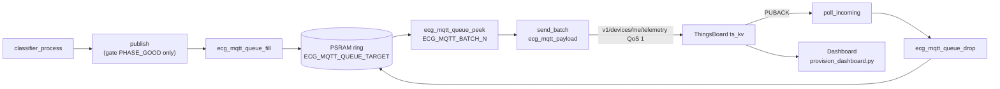

# MQTT telemetry

Each classified beat is queued in a PSRAM ring buffer and published to ThingsBoard over a hand-written MQTT 3.1.1 client. **The queue only drops a batch after the broker acknowledges it with PUBACK, so a lost connection loses no beats until the ring itself overflows.**



## How it works

**Publish path.** `publish` (`classifier.cpp:74`) runs once per classified beat. It does nothing when MQTT is inactive, and withholds the beat (counted in `h.withheld`) unless the calibration gate is in `PHASE_GOOD` and the beat is not `signal_lost`. A published beat becomes an `ecg_mqtt_beat_t`: `bpm` is `60 / RR`, `confidence` is the probability of the predicted class, and `ecg_snippet` is `ECG_SNIPPET_N` (8) samples of the beat window scaled by 1000. The beat timestamp is session milliseconds, converted to epoch time only at send.

**Backlog ring.** `main.cpp:51` (`ps_malloc` of the ring) allocates `ECG_MQTT_QUEUE_TARGET` (27000) entries in PSRAM and attaches them with `ecg_mqtt_queue_attach`. If the allocation fails, the queue stays on a static array of `ECG_MQTT_QUEUE_MIN` (64) entries. When the ring is full, `ecg_mqtt_queue_fill` (`ecg_mqtt.cpp:24`) overwrites the oldest beat and increments `ecg_mqtt_queue_lost`. The ring lives in volatile memory, so a reboot loses unsent beats.

**Client state machine.** `ecg_mqtt_service` (`ecg_mqtt.cpp:295`) runs from `loop()` and returns immediately unless `PERIOD_SERVICE_MS` (20 ms) has passed. It never waits on the network in place: CONNECT, PUBLISH and PINGREQ are written, and the reply is collected on a later iteration.

| Step | Behavior |
|---|---|
| Clock | `sync_clock` (`ecg_mqtt.cpp:279`) sets `ts_base_ms` from `gettimeofday()` once the epoch is at least `EPOCH_SNTP_MIN`. The status stays `tunggu-jam` and nothing is sent until then. `configTzTime("WIB-7", ...)` keeps the display clock in local time after WiFi reconnects. |
| Connect | The broker host must be an IPv4 literal (`IPAddress::fromString`); DNS would block past the time budget. Retries wait `RETRY_PAUSE_MS` (5 s). TCP connect times out at `CONNECT_TIMEOUT_MS` (300 ms), writes at `WRITE_LIMIT_MS` (200 ms). `setNoDelay(true)` and `WiFi.setSleep(false)` avoid delayed acknowledgements. |
| Auth | `send_connect` (`ecg_mqtt.cpp:150`) uses client id `esp32-ecg`, username = device access token, no password, keep-alive `MQTT_KEEPALIVE_S` (60 s). `poll_connack` (`ecg_mqtt.cpp:176`) gives up after 2 s. |
| Publish | `send_batch` (`ecg_mqtt.cpp:195`) sends up to `ECG_MQTT_BATCH_N` (50) beats as one QoS 1 PUBLISH (`MQTT_PUBLISH_QOS1`) to topic `v1/devices/me/telemetry`, with one packet in flight. |
| Acknowledge | `poll_incoming` (`ecg_mqtt.cpp:224`) matches PUBACK by packet id, then `ecg_mqtt_queue_drop` removes the batch from the ring. No PUBACK within 5 s disconnects and counts a failure; the batch stays in the ring and is sent again after reconnect. |
| Keep-alive | A PINGREQ goes out after `PERIOD_PING_MS` (30 s) of silence. |

**Status string** (`ecg_mqtt_status`, `ecg_mqtt.cpp:361`): `mati` (inactive), `no-wifi`, `no-broker`, `tunggu-jam` (waiting for the clock), `online`. The serial status command prints it with the sent count (`status`, `serial_cmd.cpp:36`).

**Counters.** `ecg_mqtt_sent` (beats acknowledged), `ecg_mqtt_failed`, `ecg_mqtt_packet_send` and `ecg_mqtt_packet_ack` (packets, the basis of the packet delivery ratio), `ecg_mqtt_rtt_max`, `ecg_mqtt_rtt_slow` (PUBACK slower than 1000 ms).

## Payload

A single beat is a JSON object, several beats are a JSON array of the same objects (`ecg_mqtt_payload`, `ecg_mqtt.cpp:71`):

```json
{"ts":1700000000500,"values":{"bpm":72.0,"rr_interval_ms":833.3,"label":0,"label_str":"Normal","confidence":0.9876,"signal_quality":"good","ecg_snippet":[0,1,2,3,4,5,6,7]}}
```

| Key | Content |
|---|---|
| `ts` | Epoch milliseconds: `ts_base_ms` plus the beat time. The timestamp belongs to the device, not to the server arrival time. |
| `bpm`, `rr_interval_ms` | Heart rate and the RR interval that produced it. |
| `label`, `label_str` | `0` / `"Normal"` or `1` / `"Aritmia"` (arrhythmia). |
| `confidence` | Probability of the predicted class, four decimals. |
| `signal_quality` | `"good"` or `"poor"`; only `PHASE_GOOD` beats are queued, so published beats carry `"good"`. |
| `ecg_snippet` | `ECG_SNIPPET_N` integers sampled evenly across the beat window. |

`ecg_mqtt_payload` returns 0 when the buffer is too small, and `send_batch` then disconnects. ThingsBoard keys are snake_case, matching the payload table of the thesis; hand-written Rule Engine scripts must use these names.

## ThingsBoard side

`dashboard/docker-compose.yml` runs a single `thingsboard/tb-postgres` container (service `tb`, container `tb-pa`) with an in-memory queue and persistent volumes. Ports: 8080 maps to the UI and REST API, 1883 to MQTT device transport.

1. `cd dashboard && docker compose up -d`; the REST API answers after the database schema is installed.
2. `python3 smoke_test.py` creates the device `esp32s3-ekg-01` through REST (`provision`, `smoke_test.py:31`) and tests the path without hardware: CONNECT with the token, one single record and one batch reach `ts_kv` with their own `ts`, and republishing an identical `ts` upserts instead of adding a row. That last assertion is what makes a QoS 1 resend harmless, so the stock Save Timeseries node needs no extra rule chain.
3. `python3 provision_dashboard.py` builds the dashboard "Pemantauan EKG" through REST and exports `dashboard_ekg.json`; it deletes an existing dashboard of the same title first.

The dashboard has seven stock widgets (`WIDGETS`, `provision_dashboard.py:14`): latest-value cards for `bpm`, `label_str`, `signal_quality` and `confidence`, time series charts for `bpm` and `rr_interval_ms` (separate charts because their value ranges differ by a factor of ten), and a history table. Each `typeFullFqn` carries the scope prefix `system.`; without it REST accepts the dashboard and the UI shows every widget as failed to load, so the script re-reads each widget type after saving.

`ukur_pipeline.py` measures end-to-end latency (lower and upper bound, corrected for the board versus laptop clock offset) and the packet delivery ratio from the firmware counters through serial. `probe_rtt.py` measures round-trip time on a separate device so the real telemetry stays clean. Measured results are in [mqtt-walkthrough.md](../../model/docs/mqtt-walkthrough.md).

## Interfaces

| Interface | Details |
|---|---|
| MQTT target | Broker IPv4, port 1883 plaintext, username = device access token, topic `v1/devices/me/telemetry`. Targets come from `BROKER_DAFTAR` and are described in [network-settings.md](network-settings.md). |
| Serial status | `ecg_mqtt_status`, sent count and backlog printed by `status` in `serial_cmd.cpp`. |
| Toggle | `ecg_mqtt_set_active` (`ecg_mqtt.cpp:350`) turns the client and radio session on or off. |
| Dashboard UI | <http://localhost:8080>, tenant login from the ThingsBoard defaults. |

## Limits and out of scope

- The ring is volatile PSRAM; unsent beats do not survive a reboot.
- One device per patient; there is no patient identifier in `values`.
- TLS is not used; the transport is plaintext MQTT on the local network.
- Replies longer than 127 bytes of remaining length are treated as protocol errors, which is enough for CONNACK, PUBACK and PINGRESP.

**Code:** `firmware/include/ecg_mqtt.h` · `firmware/src/ecg_mqtt.cpp` · `firmware/src/classifier.cpp` · `dashboard/docker-compose.yml` · `dashboard/smoke_test.py` · `dashboard/provision_dashboard.py` · `dashboard/ukur_pipeline.py` · tests `firmware/test/test_mqtt/`
