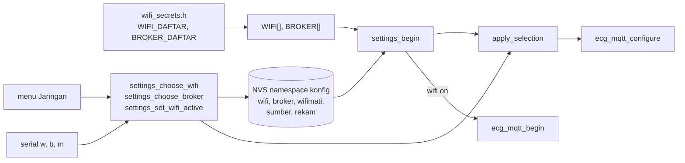

# Network settings

The board connects to one WiFi network and one ThingsBoard MQTT broker at a time, both chosen from lists compiled into `include/wifi_secrets.h`. **The chosen indices, the WiFi on/off switch and the signal source persist in NVS, and the board and the laptop that runs the broker must be on the same WiFi network, because the broker host is a literal IP address.**



## How it works

### Lists

`app_settings.cpp` includes `wifi_secrets.h` when it exists (`__has_include`, `app_settings.cpp:14`) and builds two arrays from its macros (`app_settings.cpp:30`, `WIFI`; `app_settings.cpp:31`, `BROKER`):

| Macro | Entry | Content |
|---|---|---|
| `WIFI_DAFTAR` | `{ssid, password}` | 2.4 GHz networks the broker laptop is also on |
| `BROKER_DAFTAR` | `{display name, host, port, token}` | `host` is an IPv4 address, `port` the plaintext MQTT port (1883), `token` the ThingsBoard device access token; the display name is only used in lists and logs |

`include/wifi_secrets.h` is git-ignored; the format reference is [`firmware/include/wifi_secrets.example.h`](../../firmware/include/wifi_secrets.example.h) (`wifi_secrets.example.h:4`, `WIFI_DAFTAR`; `wifi_secrets.example.h:9`, `BROKER_DAFTAR`). Without the file the firmware still builds and runs with MQTT disabled (`ecg_mqtt_begin`, `ecg_mqtt.cpp:264`, prints one line at boot). The single-entry macros `WIFI_SSID`, `WIFI_PASS`, `TB_HOST`, `TB_PORT`, `TB_TOKEN` are also accepted and become one-entry lists (`app_settings.cpp:18`, `app_settings.cpp:21`). The lists may be shortened; a stored index past the end of a list falls back to entry 0 (`read_stored`, `app_settings.cpp:40`).

Rules for the entries:

- `host` must be an IP address. Host names, including `localhost`, are not resolved: `ecg_mqtt_service` (`ecg_mqtt.cpp:295`) rejects a host that does not parse as an IP (`ecg_mqtt.cpp:312`) and MQTT stays down. `localhost` would also mean the board itself.
- The firmware does not use TLS; the broker port must be a plaintext MQTT port that the server firewall allows.
- The board and the broker laptop must be on the same SSID, because the IP is only reachable inside that network. `make broker-info` in `model/` prints the SSID, LAN IP, port state and a suggested entry for the laptop.

### Persistence

Values are stored with `Preferences` in the NVS namespace `konfig` (`NS`, `app_settings.cpp:35`):

| NVS key | Type | Holds | Default |
|---|---|---|---|
| `wifi` | uint8 | Selected WiFi index | 0 |
| `broker` | uint8 | Selected broker index | 0 |
| `wifimati` | uint8 | 1 when WiFi is switched off | 0 (WiFi on) |
| `sumber` | uint8 | Signal source (ADC, reference, recording) | 0 (ADC) |
| `rekam` | uint16 | Recording number when the source is a recording | 0 |

`settings_begin` (`app_settings.cpp:67`, `settings_begin`) reads all of them, hands the selection to `ecg_mqtt_configure` through `apply_selection` (`app_settings.cpp:57`) and then starts MQTT, or leaves it inactive when WiFi is off. It reads the switch before the radio is started, so with WiFi off `WiFi.begin()` is never called at boot. `settings_set_source` (`app_settings.cpp:133`, `settings_set_source`) writes the source keys when they change; `acquisition_begin` restores them.

### Choosing

`settings_choose_wifi` (`app_settings.cpp:92`, `settings_choose_wifi`) and `settings_choose_broker` (`app_settings.cpp:121`, `settings_choose_broker`) validate the index, write it to NVS and reconfigure MQTT. With WiFi on, choosing a WiFi entry also restarts the connection; with WiFi off the radio stays off. `settings_set_wifi_active` (`app_settings.cpp:104`, `settings_set_wifi_active`) stores `wifimati` and either starts the radio and MQTT or deactivates MQTT and stops the radio. Returning from a power mode to normal operation (`power_set_mode`, `power.cpp:49`) switches the radio on only when WiFi is on. All three are refused during a recording session, because switching the radio on mid-recording on battery can reset the board.

Entry points: menu "Jaringan" (network) with "WiFi aktif" (WiFi on), "WiFi", "Broker" and "Status" ([buttons-and-menu](buttons-and-menu.md)); serial `m`, `w`, `w<n>`, `b`, `b<n>` ([serial-commands](serial-commands.md)). Entry numbers start at 0.

### MQTT status

`ecg_mqtt_status` (`ecg_mqtt.cpp:370`, `ecg_mqtt_status`) returns the state shown on the menu status page, `ecg_mqtt_status_serial` (`ecg_mqtt.cpp:371`, `ecg_mqtt_status_serial`) the same state for serial `s`:

| Menu | Serial `s` | Meaning |
|---|---|---|
| `mati` | `off` | MQTT is deactivated |
| `no-wifi` | `no-wifi` | WiFi is not connected |
| `no-broker` | `no-broker` | WiFi is connected, the broker is not |
| `tunggu-jam` | `no-clock` | Connected, waiting for clock sync |
| `online` | `online` | Normal |

## Procedure: configure and switch the server

1. Start ThingsBoard on the laptop and read the device access token:

   ```bash
   cd dashboard && docker compose up -d
   python3 smoke_test.py
   ```

2. Print the SSID, LAN IP, port state and a suggested entry:

   ```bash
   cd model && make broker-info
   ```

   Port 1883 must be open (ThingsBoard MQTT); Docker, bridge, veth and loopback interfaces are ignored because the board cannot see them.

3. Copy `include/wifi_secrets.example.h` to `include/wifi_secrets.h` (once), then fill `WIFI_DAFTAR` with the laptop SSID and `BROKER_DAFTAR` with the laptop IP and token.
4. Build and flash: `pio run -t upload`.
5. Select the active entries (stored in NVS): serial `w` and `b` list the entries with `*` on the active one; `w<n>` and `b<n>` select and reconnect; or use the menu "Jaringan" lists, where a long press on B2 chooses an entry.
6. Check serial `s`: the MQTT status is `online` and the sent count grows. In the ThingsBoard UI (`http://localhost:8080`) the device's latest telemetry receives new beats.

Switching between entries that already exist needs only step 5. Adding or changing an entry, including a laptop IP that changed, needs steps 3 to 5.

### Another server

The broker can be a ThingsBoard on another computer in the same network or on a VPS if: it is reachable from the board's WiFi by IP address (LAN IP, or public IP for a VPS; DNS names are not supported), the plaintext MQTT port (default 1883) is open in its firewall, and the token comes from a device on that server (run `smoke_test.py` there, since it uses `localhost:8080`, or copy it from the UI: Entities, Devices, the device, Copy access token). Then add `{"name", "IP", 1883, "token"}` to `BROKER_DAFTAR` and continue from step 4.

## Troubleshooting

| Symptom | Cause | Action |
|---|---|---|
| `no-broker` all the time, port 1883 open on the laptop | Board and laptop are on different SSIDs | Compare the `SSID` line of `make broker-info` with the active entry from serial `w`; move the laptop to the board's SSID or add a matching WiFi entry |
| Broker unreachable after a network change or laptop restart | The laptop IP changed (DHCP) | `make broker-info`, update the IP in `BROKER_DAFTAR`, reflash; a DHCP reservation prevents it |
| `make broker-info` reports port 1883 closed | ThingsBoard is not running or still booting | `cd dashboard && docker compose up -d`, wait about 2 minutes, retry |
| Port open, same SSID, still `no-broker` | The laptop firewall blocks inbound TCP 1883 | Allow inbound TCP 1883 from the LAN subnet |
| Same SSID, firewall open, still `no-broker` | AP or client isolation (common on campus, office and public WiFi) blocks client-to-client traffic | Use a phone hotspot or your own router for board and laptop |
| `no-wifi` all the time | Wrong SSID or password, or a 5 GHz-only network | Check `WIFI_DAFTAR`; the ESP32-S3 supports 2.4 GHz only |
| Host rejected as not an IP | `host` holds a name | Use the IP from `make broker-info` |
| MQTT disabled at boot | `include/wifi_secrets.h` is missing | Step 3 |

## Interfaces

| Interface | Details |
|---|---|
| `settings_begin`, `settings_*` getters | Used by `main.cpp`, `menu.cpp`, `serial_cmd.cpp`, `acquisition.cpp` (`app_settings.h`). |
| Serial `m`, `w`, `b` (`serial_cmd.cpp:112`, `serial_cmd_service`) | WiFi switch and entry selection. |
| Menu "Jaringan" (`menu.cpp:228`, `H_NETWORK`) | Same actions from the buttons. |

## Limits and out of scope

- One WiFi and one broker are active at a time; no automatic fallback to another entry.
- MQTT payloads, queueing and the backlog are in [mqtt-telemetry](mqtt-telemetry.md); the MQTT protocol detail is in [model/docs/mqtt-walkthrough.md](../../model/docs/mqtt-walkthrough.md).

**Code:** `firmware/include/app_settings.h` · `firmware/src/app_settings.cpp` · `firmware/include/wifi_secrets.example.h` · `firmware/src/ecg_mqtt.cpp` · `model/scripts/broker_info.py`
