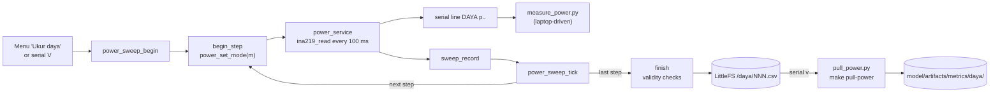

# Power measurement

An INA219 on the battery side measures the current the whole device draws, and a six-step sweep (`p0` to `p5`) turns that into the per-stage cost of the firmware. **A sweep step is valid only if the bus voltage is above 1 V, no samples were lost, beats were produced from `p2` upward, and the current rose by more than twice the standard deviation over the previous step.**



## How it works

**Sensor.** `ina219.cpp` reads the shunt and bus registers over I2C (address `INA219_ADDRESS` 0x40, pins `I2C_SDA` and `I2C_SCL`). `INA219_CONFIG` = `0x3FFF` selects the plus or minus 320 mV range, which on the 0.1 ohm shunt (`R_SHUNT` in `board.h`) is plus or minus 3.2 A at 0.1 mA resolution; the 128-sample conversion averages WiFi transmit bursts. `ina219_current_mA` (`ina219.cpp:3`) converts the shunt register at 10 uV per count divided by `R_SHUNT`, and `ina219_bus_V` drops the three status bits and multiplies by 4 mV. `ina219_begin` (`ina219.cpp:40`) writes the configuration and succeeds only if it reads the same value back. The conversion functions are pure C, which is why `test_ina219` runs on the PC.

**Module not fitted.** The INA219 module is not on the board yet. Until it is fitted, the `INA219` field of the serial status command reads `not responding`, serial `V` and the menu sweep stop at `sweep: INA219 not detected, cancelled`, and `test_hw_ina219` fails with `INA219 0x40 tidak menjawab (SDA17 SCL18)`. No power number can be measured before the module is fitted on the battery path described below.

**Circuit.** The battery path is 18650, TP4056 `OUT+`, INA219 `VIN+`, shunt, `VIN-`, DC-DC converter input, converter output to the 5V pin. The INA219 logic side is on 3V3, GND, SDA GPIO 17 and SCL GPIO 18; its `VCC` must be 3V3 because the module's I2C pull-ups follow `VCC`. Circuit GND comes from TP4056 `OUT-`, not `B-`, so the cell protection stays in the path. Measuring on the battery side makes the reading the true cell current including converter loss, so battery life is capacity (mAh) divided by measured current with no efficiency assumption. The current path joints are soldered because the whole device current flows through them. Pin and board details are in `hardware/mainboard/README.md`.

**Measuring conditions.**

1. Unplug USB from the board and the charger input of the TP4056, otherwise VBUS powers the board and the reading does not represent the device.
2. Power the device from the battery. The top row of the monitor screen and the `INA219` line of the serial status command show current, voltage and power.
3. A correct reading has `V` between 3.0 and 4.2 V and a stable positive `I`.

| Reading | Meaning | Action |
|---|---|---|
| `V` about 0 V, `I` jumps | `VIN+` or `VIN-` floating | Check the `VIN` wiring |
| `I` negative | `VIN+` and `VIN-` swapped | Swap the two wires; nothing is damaged |
| `I` about 0 mA with the device on | Current flows through another path (USB still plugged) | Unplug USB |
| INA219 does not answer | I2C wiring or module `VCC` | `pio test -e esp32-s3 -f test_hw_ina219 -v` |

The battery-side current exceeds the 5V-side current by V_out / (V_battery x converter efficiency), so WiFi bursts read highest near 3.0 V. The `OVF` bit of the bus register marks current beyond the range.

**Stages.** `power_set_mode(m)` (`power.cpp:49`) selects what runs; `power_stage(t)` (`power.cpp:35`) is true when the mode is normal (-1) or at least `t`, and `main.cpp` uses it to gate each stage of the loop.

| Mode | Adds | Mechanism |
|---|---|---|
| `p0` | baseline | `acquisition_timer(false)`: the 360 Hz timer ISR is off |
| `p1` | ISR 360 Hz | timer on, nothing consumes samples beyond the queue |
| `p2` | DSP | `ecg_live_push` (`power_stage(2)`) |
| `p3` | CNN inference | `classifier_process` (`power_stage(3)`) |
| `p4` | UI | `display_beat`, `display_sample`, LED, buzzer (`power_stage(4)`) |
| `p5` | WiFi and MQTT | radio and MQTT client running |

In modes `p0` to `p4` the radio is stopped with `esp_wifi_stop()` and MQTT is deactivated; leaving them restarts the radio only when WiFi is enabled in settings (`settings_wifi_active`). `p5` therefore equals `p4` when WiFi is off, and the step is then flagged invalid by the rise test. Mode changes are refused while recording (`recorder_reject`).

**Window measurement.** `power_service` (`power.cpp:71`) reads the INA219 every `PERIOD_READ_INA219_MS` (100 ms) and, after `WINDOW_DURATION_MS` (`POWER_WINDOW_MS`, default 10 s), prints one line per window. This line is a frozen protocol line that `measure_power.py` matches with `POWER_LINE_PATTERN` (`measure_power.py:13`):

```
DAYA p<m> n=<n> I=<mA> sd=<mA> mA V=<V> P=<mW> mW beat=<n> lewat=<n> replay=<0|1>
```

as printed by `printf("DAYA p%d n=%d I=%.2f sd=%.2f mA V=%.3f P=%.1f mW beat=%u lewat=%u replay=%d\n", ...)`: `n` is the sample count, `I` and `sd` the mean and standard deviation of current, `beat` the beats processed in the window, `lewat` the samples missed by the acquisition (`acquisition_missed`), `replay` whether a replay source was active.

**Standalone sweep.** `power_sweep_begin` (`power.cpp:171`; menu item "Ukur daya" > "Mulai tangga p0-p5", or serial `V`) runs all six steps on the board without a laptop, so no USB cable powers the board. It needs the INA219 to be detected. If the signal source is the ADC it switches to the reference replay for the sweep and restores the source at the end. Each step discards its first window (transient) and keeps `POWER_BLOCK` (6) windows of 10 s, so the sweep lasts `SWEEP_N` x (`POWER_BLOCK` + 1) x 10 s = 420 s. `power_sweep_tick` (`power.cpp:250`) advances steps from `loop()` and cancels the sweep if a window does not arrive in time or the mode is changed from outside. The menu closes while the sweep runs so the `p4` step measures the real UI load; no button should be pressed.

`finish` (`power.cpp:185`) averages the windows of each step and applies the validity rules; any failed rule prints an `INVALID` reason and a `!` suffix marks the step (`p3!`):

| Rule | Applies to |
|---|---|
| minimum bus voltage below 1 V | every step |
| samples missed (`lewat`) above 0 | `p1` and up |
| no beats | `p2` and up |
| current drop, or rise not above 2 x the larger standard deviation | `p1` and up, against the previous step |

The result file `/daya/NNN.csv` (next free number, directory created on demand) has the header `waktu,mode,n,I_mA,sd_mA,V,P_mW,beat,lewat,replay,sah`. The timestamp is ISO 8601 UTC when the clock is synced, otherwise `+<seconds>s`. The menu page "Ukur daya" > "Hasil terakhir" (`power_fill`, `menu.cpp:155`) shows one row per step and the file number `#NNN`.

**Serial.** `V` starts the sweep, `v` lists files in `/daya`, `v<n>` dumps file `n` between `---MULAI---` and `---SELESAI---`, `p0` to `p5` select one step (one `DAYA` line per window), and `p` followed by any other character returns to normal operation. A short test of the sweep path without waiting 7 minutes is a build with `-DPOWER_WINDOW_MS=2000 -DPOWER_BLOCK=2`.

## Pulling results

1. Plug USB into the laptop and close other serial monitors.
2. From `model/`:

```bash
make pull-power          # last file
make pull-power N=3      # /daya/003.csv
ECG_PORT=/dev/ttyACM1 make pull-power
```

`pull_power.py` lists files with `v`, dumps the chosen one with `v<n>`, and saves it as `model/artifacts/metrics/daya/<YYYYmmdd-HHMM>-board-NNN.csv`. It prints a per-mode summary (mean current with standard deviation, voltage, power, delta current, beats, missed samples, board verdict) and revalidates with `validate_rings` (`pull_power.py:28`), which applies the same rules as the firmware. It exits with code 1 and prints `FAIL (INVALID)` with the reasons when a step is invalid.

## Laptop-driven sweep

`measure_power.py` drives the board over serial instead: it turns replay on if needed, sends `p<m>` for each mode in `--mode` (default `012345`), collects `--blocks` (default 6) `DAYA` lines per mode after discarding the first, refuses to continue if the bus voltage is below 1 V unless `--force`, restores normal mode with `px` and the original replay state, and writes `model/artifacts/metrics/daya/<YYYYmmdd-HHMM>.csv`. This path keeps USB attached, so USB powers the board; the standalone sweep is the one that measures battery operation.

## Interfaces

| Interface | Details |
|---|---|
| Serial `V`, `v`, `v<n>`, `p0`..`p5` | `power_serial` (`power.cpp:272`), `p` branch in `serial_cmd.cpp:100` |
| Menu "Ukur daya" (measure power) | `H_POWER_MENU` (`menu.cpp:181`) and result page `H_POWER` (`menu.cpp:170`) |
| `make pull-power [N=]` | `model/Makefile` target `pull-power` |
| `DAYA` line | `power_service` (`power.cpp:71`) |

## Limits and out of scope

- A sweep with WiFi disabled in settings cannot validate `p5`.
- Validity rules detect an unmeasurable step; they do not certify that the INA219 is on the battery side.

**Code:** `firmware/include/power.h` · `firmware/src/power.cpp` · `firmware/include/ina219.h` · `firmware/src/ina219.cpp` · `model/scripts/measure_power.py` · `model/scripts/pull_power.py` · tests `firmware/test/test_ina219/` · `firmware/test/test_hw_ina219/`
