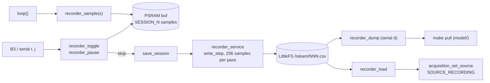

# Recording

Raw ADC samples from the sensor are recorded into a PSRAM buffer, pause and resume at will, and are written to numbered CSV files in LittleFS only after the session stops. **Writing a file never blocks sampling, and a limit (storage, file numbers, session length) never drops samples silently: the session stops itself and says why, or refuses to start.**



## How it works

### Session

- `recorder_prepare` (`recorder.cpp:94`, `recorder_prepare`) allocates the buffer in PSRAM (`SESSION_N` = `RECORDER_N * RECORDER_PART_MAX` samples of 16 bits), mounts LittleFS (formatting it on failure) and creates `/rekam`. A file `/rekaman.csv` left from an older layout is renamed to `/rekam/001.csv` when no numbered file exists.
- `recorder_toggle` (`recorder.cpp:256`, `recorder_toggle`) starts or stops a session. On start it computes the session length: `part_max = min(RECORDER_PART_MAX, free LittleFS bytes / FULL_FILE_SPACE)`, then `min(part_max, RECORDER_NUMBER_MAX - last file number)`. `FULL_FILE_SPACE` (`recorder.cpp:19`) is `RECORDER_N * BYTES_PER_SAMPLE_MAX` = 108,000 samples x 6 B = 648,000 B, an upper bound for one file.
- `recorder_sample` (`recorder.cpp:246`, `recorder_sample`) appends each sample from `loop()` unless paused, counts lead-off samples (either `PIN_LOP` or `PIN_LON` high) and the acquisition missed-sample counter per part. When `session_limit` is reached the session ends itself (`stopped_full`) and `recorder_service` (`recorder.cpp:229`, `recorder_service`) saves it with the reason on serial and the TFT.
- `recorder_pause` (`recorder.cpp:290`, `recorder_pause`) toggles pause and records the sample index of each pause in `breaks` (up to `BREAKS_MAX` = 64; beyond that segments merge and a warning is printed).

| Constant | Value | Role |
|---|---|---|
| `RECORDER_SECONDS_MAX` (`recorder.h:17`) | 300 | Seconds per file |
| `RECORDER_PART_MAX` (`recorder.h:22`) | 6 | Files per session at most |
| `RECORDER_NUMBER_MAX` (`recorder.h:13`) | 999 | Highest file number |
| `SAMPLES_PER_WRITE` (`recorder.cpp:20`) | 256 | Samples formatted and written per loop pass |
| `BEEP_SAVE_MS` (`recorder.cpp:24`) | 400 | Beep after the last file is written |

The three limits can be changed at build time with `-DRECORDER_SECONDS=<k>`, `-DRECORDER_PART=<k>` and `-DRECORDER_NUMBER=<k>` (for example `PLATFORMIO_BUILD_FLAGS="-DRECORDER_SECONDS=10" pio run -t upload` for 10 s parts and a 60 s session), so the limits can be exercised without waiting.

### Refusals

`recorder_toggle` refuses to start (`reject`, `recorder.cpp:263`) when the source is not the sensor, a power mode `p0`-`p5` is active, the menu is open, the previous session is still being written, PSRAM is missing, the file numbers are used up, or not one part fits in LittleFS. It prints the reason on serial and shows a TFT message ("TOLAK" rejected, "PENUH" full, "TUNGGU" wait). Refusing instead of closing the menu forcibly keeps one rule for buttons and serial: a recording starts from the monitor screen.

### Writing

`save_session` (`recorder.cpp:215`, `save_session`) splits the session into `ceil(n / RECORDER_N)` files numbered from `last() + 1` and opens the first. `recorder_service` calls `write_step` (`recorder.cpp:189`, `write_step`) once per loop pass, and only when the acquisition queue is empty, so a slice of 256 samples is formatted and written between samples instead of stalling the sampler. `close_write` (`recorder.cpp:154`, `close_write`) closes the file; after a complete write it compares the size on flash with the bytes written, prints the saved line, warns when lead-off samples exceed 10 % of the file, opens the next part and, after the last, sounds the save beep. The TFT top right shows "SIMPAN.." (saving) while writing and "SIMPAN" (saved) with the file name for 3 s afterwards (`recorder_newly_saved`).

If a file cannot be opened (`open_part`, `recorder.cpp:124`) or a write returns fewer bytes than were formatted, as on a full LittleFS (`write_step` calls `close_write(true)`), `keep_in_psram` (`recorder.cpp:115`, `keep_in_psram`) sets `held_back`. Serial prints `FAILED to open <path>: parts <k>-<N> kept in PSRAM, retry the save with r / hold B3`, or for a write `FAILED: LittleFS full after <samples> samples, <path> truncated` followed by `FAILED to write <path>: parts <k>-<N> kept in PSRAM, retry the save with r / hold B3`. The unwritten parts stay in PSRAM, the TFT shows "GAGAL SIMPAN" (save failed) with the reject beep, no `SIMPAN` line or save beep follows, and a new session cannot start. `r` or a long press on B3 retries from the failed part: `open_part` reopens the same file with `"w"`, which replaces the truncated file, and the remaining parts follow. On a LittleFS that is really full the retry fails the same way; pull and delete older recordings first (`make pull N=<n>`, then `h<n>`), then press `r`. A reset before the retry loses the parts in PSRAM, and the truncated file keeps only what was written before the failure.

The build flag `-DRECORDER_FAIL_WRITE_PART=<k>` makes the first write of part `k` (1 = the first file of a session) return 0 bytes once per boot, the same result `File::write` gives on a full LittleFS (`inject_write_failure`, `recorder.cpp:181`). Without the flag the code is compiled out.

Procedure: failed-write test

1. From `firmware/`, flash 10 s parts with a failing first part:

   ```bash
   PLATFORMIO_BUILD_FLAGS="-DRECORDER_SECONDS=10 -DRECORDER_FAIL_WRITE_PART=1" pio run -t upload
   ```

2. Serial `l`. With `recorder: 0 files` the session is written to `/rekam/001.csv` to `003.csv`; otherwise numbering starts after the last file.
3. Serial `r`, wait until `REC part 3 (in PSRAM, written on stop)` appears (about 25 s), then `r`. Expected:

   ```
   REC stopped: <n> samples (<seconds> s), writing 3 files from PSRAM
   FAILED: LittleFS full after 256 samples, /rekam/001.csv truncated
   FAILED to write /rekam/001.csv: parts 1-3 kept in PSRAM, retry the save with r / hold B3
   ```

4. Serial `r` again. Expected: three `SIMPAN` lines whose sample counts add up to `<n>` from step 3, and `l` lists three files with `lewat=0` (board N16R8, 23 Nov 2026: 8,661 = 3,600 + 3,600 + 1,461).
5. Delete the test files with `h<n>` and flash the default build with `pio run -t upload`.

### Session lock

While a session is open (recording or paused), `recorder_reject` (`recorder.cpp:55`, `recorder_reject`) returns true and prints a refusal. It is called inside the target functions, so every path to them is locked:

| Target | Caller site |
|---|---|
| Open the menu | `menu_open` (`menu.cpp:328`) |
| Change signal source | `acquisition_set_source` (`acquisition.cpp:122`) |
| Power mode, power sweep | `power_set_mode` (`power.cpp:49`), `power_sweep_begin` (`power.cpp:171`) |
| Skip calibration gate | `gate_set_skip` (`gate.cpp:48`) |
| WiFi, broker, WiFi on/off | `settings_choose_wifi` (`app_settings.cpp:92`), `settings_choose_broker` (`app_settings.cpp:121`), `settings_set_wifi_active` (`app_settings.cpp:104`) |

B1 and B2 short presses, B3, serial `r`, `j`, `s`, `l`, `q`, `v` and `h<n>` stay available; serial `d` is refused while recording. To change the source, run a device test, measure power or change the network, save the recording first. The board-level check of these edge flows is `model/scripts/record_flow_check.py [port]`: seven scenarios, one PASS or FAIL line each, exit code 1 on any failure. It records about 10 s, deletes the file and restores the ADC source, and requires a board that is not recording, with the menu closed and normal power mode. The port defaults to `ECG_PORT` or the first `/dev/ttyACM*`.

### Replay load

`recorder_load` (`recorder.cpp:353`, `recorder_load`) reads a file back as ADC counts, skips `#` lines, clamps values to 4095 and stops at `RECORDER_SAMPLE_MAX` samples (300 s). `attach_source` (`acquisition.cpp:98`, `attach_source`) calls it for `SOURCE_RECORDING` and rejects a file that yields less than one second (`ECG_FS` samples), leaving the source unchanged. Because `# jeda` lines are skipped, a paused recording replays as one continuous signal. `recorder_sample_n` (`recorder.cpp:341`, `recorder_sample_n`) reads `n=` from the header for the menu list.

## Data contract

File `/rekam/NNN.csv` (`RECORDER_PATTERN`, `recorder.h:9`):

```
# fs=360 n=<total samples> lewat=<missed> lepas=<lead-off> (<percent>%) [lanjutan=<NNN> celah=<c>]
<ADC counts, one sample per line>
# jeda
<ADC counts of the next segment>
```

| Token | Meaning |
|---|---|
| `fs`, `n` | Sampling rate and the sample count of all segments in this file (`open_part`, `recorder.cpp:124`) |
| `lewat` | Samples missed during this part |
| `lepas` | Samples taken with an electrode off (lead-off pin high), with its percentage |
| `lanjutan=NNN celah=0` | Only on files after the first of a session: the previous file's number, and a gap of 0 samples, which is always written as 0 (`recorder.cpp:147`) |
| `# jeda` | Written by `write_step` (`PAUSE_LINE`, `recorder.cpp:21`) between the segments recorded before and after a pause; adjacent segments are not continuous in time. Absent when the recording has no pause |

`recorder_dump` (`recorder.cpp:302`, `recorder_dump`) first flushes any pending write, then prints the file between `---MULAI---` and `---SELESAI---` (serial `d` or `d<n>`). `recorder_print_list` (`recorder.cpp:327`) prints number, size and header of each file with the LittleFS usage (serial `l`); `recorder_delete` (`recorder.cpp:317`) removes one (`h<n>`). The 300 s limit per file does not count paused time.

## Procedure: record and pull

1. On the monitor screen, short-press B3 (or send `r`). The top right shows `RECmm:ss` in red.
2. Short-press B3 to pause ("JEDA" in yellow) and again to resume; repeat as needed.
3. Hold B3 for 800 ms (or send `r`) to stop and save. Wait for the long beep.
4. On the laptop, from `model/`: `make pull N=<n>` (the last recording when `N` is omitted). `scripts/pull_recording.py` stops a running recording first, sends `d`, and stores the lines between the markers as `data/recordings/<yyyymmdd-HHMM>[-rekam-NNN].csv`.
5. Analyse per segment with `make analyze FILE=data/recordings/<file>.csv`. The full procedure is in [acquisition-walkthrough](../../model/docs/acquisition-walkthrough.md).
6. Delete the recording on the board with `h<n>` after each subject.

## Interfaces

| Interface | Details |
|---|---|
| B3 short / long | Start, pause or resume; stop and save (map in [buttons-and-menu](buttons-and-menu.md)). |
| Serial `r`, `j` (`serial_cmd.cpp:86`, `serial_cmd_service`) | Same as B3 short and long. |
| Serial `l`, `d`, `d<n>`, `h<n>` | List, dump, delete (see [serial-commands](serial-commands.md)). |
| `recorder_sample` (`main.cpp:90`) | Feeds each sample from the acquisition queue. |

## Limits and out of scope

- Only the sensor (ADC) source is recorded; replay sources are refused.
- The session, in PSRAM, is lost on reset or power loss before the save finishes.
- The acquisition queue and signal sources are in [acquisition](acquisition.md); the gate that replay bypasses is in [calibration-gate](calibration-gate.md).

**Code:** `firmware/include/recorder.h` · `firmware/src/recorder.cpp` · `model/scripts/pull_recording.py` · `model/scripts/record_flow_check.py`
