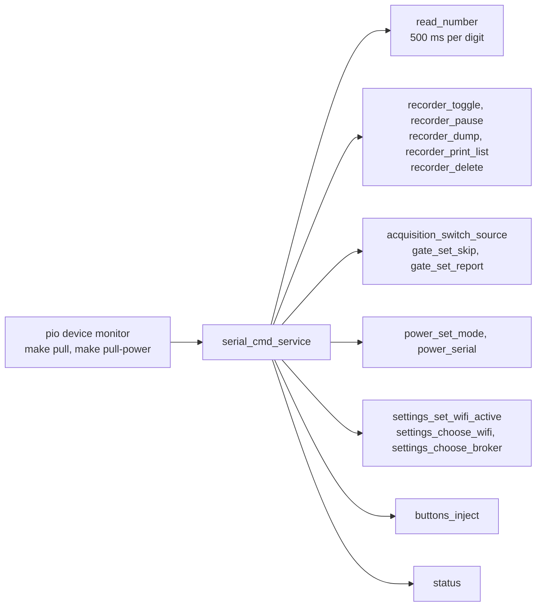

# Serial commands

`serial_cmd_service` reads single-letter commands from the USB serial port at 115200 baud and calls the module that owns each feature. **The commands are the headless twin of the buttons and menu: anything the user can do on the device can be sent and tested from a serial monitor, and the same session lock refuses the commands that would disturb a recording.**

## How it works

`serial_cmd_service` (`serial_cmd.cpp:82`, `serial_cmd_service`) is called once per loop pass, reads at most one character and dispatches on it; unknown characters are ignored and no line terminator is needed. Commands that take a number use `read_number` (`serial_cmd.cpp:22`, `read_number`): up to three digits, waiting up to `WAIT_DIGIT_MS` (500 ms, `serial_cmd.cpp:20`) for each digit, so the number can be typed directly in `pio device monitor`. It returns -1 when no digit follows. Entry numbers for WiFi and broker start at 0; recording and power-file numbers start at 1.

## Interfaces

| Command | Calls | What it does |
|---|---|---|
| `r` (`serial_cmd.cpp:86`) | `recorder_toggle` | Start a recording, or stop and save it (also from the paused state) into the next numbered file |
| `j` (`serial_cmd.cpp:87`) | `recorder_pause` | Pause or resume the recording; paused samples are not stored |
| `l` (`serial_cmd.cpp:93`) | `recorder_print_list` | List recordings with number, size and file header, and the LittleFS usage |
| `d`, `d<n>` (`serial_cmd.cpp:88`) | `recorder_dump` | Dump the last recording, or recording `<n>`, between `---MULAI---` and `---SELESAI---`; refused while recording. `make pull` in `model/` uses `d` |
| `h<n>` (`serial_cmd.cpp:94`) | `recorder_delete` | Delete recording `<n>`; without a number it prints a usage hint |
| `s` (`serial_cmd.cpp:117`) | `status` | Print the three status lines described below |
| `y` (`serial_cmd.cpp:99`) | `acquisition_switch_source` | Toggle the signal source between the ADC and the reference replay; from a recording replay it returns to the ADC. The source is stored in NVS like a menu choice, and replay bypasses the calibration gate |
| `k` (`serial_cmd.cpp:106`) | `gate_set_skip` | Toggle the calibration-gate skip (bench use); OFF starts a new session with the full gate |
| `p0`-`p5` (`serial_cmd.cpp:100`) | `power_set_mode` | Select one power-measurement step; `p` followed by any other character returns to normal operation. See [power-measurement](power-measurement.md) |
| `V` (`serial_cmd.cpp:118`) | `power_serial` | Start the standalone power ladder `p0` to `p5` (same as menu "Ukur daya", measure power, then "Mulai tangga p0-p5"); the result goes to `/daya/NNN.csv` |
| `v`, `v<n>` (`serial_cmd.cpp:118`) | `power_serial` (`power.cpp:272`) | List the files in `/daya/`, or print `/daya/<n>.csv` between `---MULAI---` and `---SELESAI---`; `make pull-power` uses it |
| `t1`-`t3`, `T1`-`T3` (`serial_cmd.cpp:129`) | `buttons_inject` | Inject a short (`t`) or long (`T`) press of B1 to B3, processed like the physical button; only one digit is read |
| `m` (`serial_cmd.cpp:112`) | `settings_set_wifi_active` | Toggle the WiFi radio and MQTT, stored in NVS |
| `w`, `w<n>` (`serial_cmd.cpp:124`) | `list_wifi`, `settings_choose_wifi` | List `WIFI_DAFTAR` with `*` on the active entry, or select entry `<n>`, store it and reconnect |
| `b`, `b<n>` (`serial_cmd.cpp:136`) | `list_brokers`, `settings_choose_broker` | List `BROKER_DAFTAR` with `*` on the active entry, or select entry `<n>`, store it and reconnect |
| `q` (`serial_cmd.cpp:113`) | `gate_set_report` | Toggle the per-second signal-quality report |

A selection that does not exist prints a hint (unless a recording session caused the refusal).

### Status lines

`status` (`serial_cmd.cpp:36`, `status`) prints three lines:

1. Signal: recording flag (`rekam=<0|1>`) and sample count, replay flag, gate phase name, beat totals (arrhythmia, withheld), acquisition queue fill, missed samples with the part lost to a held ISR tick, lead-off pin levels, raw minimum and maximum, clean swing and clipping.
2. Network: MQTT status, sent count, backlog against its capacity, lost and failed counts, packets acknowledged against sent with the delivery ratio (PDSR), mean and maximum device delay, maximum round-trip time and the count of slow ones, RSSI and the epoch in milliseconds.
3. Device: INA219 state, mute, freeze, skip, power mode, source name (`adc`, `acuan` for the reference replay, `rekaman`) with the recording number, menu open, paused.

`pull_recording.py` reads the status line and looks for `rekam=1` to stop a running recording before it dumps.

### Session lock

During a recording session (recording or paused) `y`, `p0`-`p5`, `V`, `k`, `w<n>`, `b<n>`, `m` and `T2` (which opens the menu) are refused by `recorder_reject`; `d` is refused by its own check. `r`, `j`, `s`, `l`, `q`, `v`, `h<n>` and the short-press injections keep working. The lock lives in the target functions, see [recording](recording.md).

## Limits and out of scope

- `read_number` blocks the loop for at most 1.5 s (three digits at 500 ms each) while waiting for digits; `p` waits up to 500 ms for its one character.
- The text each command prints is diagnostic output, not an interface; the exceptions are the tokens `---MULAI---`, `---SELESAI---`, `SIMPAN` and `rekam=1` that the pull scripts parse.
- The startup banner lists the available letters.

**Code:** `firmware/include/serial_cmd.h` · `firmware/src/serial_cmd.cpp` · `model/scripts/pull_recording.py` · `model/scripts/pull_power.py` · `model/Makefile`
