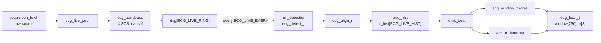

# Signal pipeline

The pipeline turns a stream of raw ADC samples into classifier-ready beats: a causal bandpass per sample, R-peak detection once per second, then a z-scored 256-sample window and three RR features per beat. **The C code must compute exactly what the Python preprocessing computes; `golden_ref.h` pins that.**

## How it works

### Per-sample filter

`ecg_live_push` (`ecg_live.cpp:115`, `ecg_live_push`) runs `ecg_bandpass` (`ecg_pipeline.cpp:7`, `ecg_bandpass`) on every sample and stores the result in `ring` of `ECG_LIVE_RING` = 4 seconds (`ecg_live.h:11`, `ECG_LIVE_RING`). The filter is `ECG_N_SOS` = 4 second-order sections (`ecg_preproc.h:31`, `ECG_N_SOS`) with the coefficients `ecg_sos` generated from `model/config.py` (0.5 to 40 Hz, `BANDPASS_LOW`, `BANDPASS_HIGH`). It is causal and carries its state between calls, as the model was trained on causally filtered windows. `ecg_live_filtered_last` (`ecg_live.cpp:172`, `ecg_live_filtered_last`) exposes the newest filtered value; the [calibration gate](./calibration-gate.md) and the display plot read it.

### R-peak detection

Every `ECG_LIVE_EVERY` samples (default `ECG_FS` = 360, one second; `ecg_live.h:12-13`) `ecg_live_push` calls `run_detection` (`ecg_live.cpp:85`, `run_detection`), but only once the ring holds `ECG_PT_INIT_N` = 2 seconds (`ecg_pipeline.h:7`, `ECG_PT_INIT_N`). `ecg_detect_r` (`ecg_pipeline.cpp:192`, `ecg_detect_r`) is a Pan-Tompkins detector over the whole ring:

1. `pt_bandpass` (`:148`, `pt_bandpass`): 2 SOS sections (`ECG_PT_N_SOS`, coefficients `ecg_pt_sos`, 5 to 15 Hz in `model/config.py`).
2. `pt_derivative` (`:165`, `pt_derivative`): five-point derivative scaled by `ECG_FS / 8`.
3. Squaring, then `pt_mwi` (`:179`, `pt_mwi`): moving-window mean of `ECG_PT_MWI_LEN` = 54 samples.
4. Thresholds start from the first `ECG_PT_INIT_N` samples: the signal level `spki` is the maximum, the noise level `npki` the mean. Accumulation uses `double` because a float sum over 720 samples loses precision.
5. A local maximum counts when it is greater than its left neighbour and at least its right neighbour, so a flat plateau gives exactly one peak. It must lie `ECG_PT_REFRACTORY` = 72 samples (200 ms) after the previous peak and above `npki + 0.25 * (spki - npki)`. Accepted peaks update `spki`, rejected ones `npki`, both with weight 0.125 (`:223-230`).

`ecg_align_r` (`:236`, `ecg_align_r`) moves each coarse peak to the maximum of the filtered signal within `ECG_PT_REFINE` = 25 samples around `r_coarse - ECG_PT_OFFSET` (38) and subtracts `ECG_GROUP_DELAY` (4).

### Beat history and emission

`run_detection` converts each aligned peak to an absolute sample index `r_abs` and skips it when it is within the refractory period of `r_last`, when its 128-sample pre-window starts before the ring, or when its 128-sample post-window is not yet complete. Absolute indexes (not ring positions) identify beats: the history `r_hist` of `ECG_LIVE_HIST` = 16 peaks shifts when full (`add_hist`, `:51`), so positions would go stale and a beat could be emitted twice. At most 8 new peaks are queued per detection (`:109`).

`ecg_live_push` pops one queued peak per call and emits a beat when the history holds at least 3 peaks and the peak sits at index 2 or later (`:131-138`), because the RR features need two earlier intervals. The first two beats after `ecg_live_reset` (`ecg_live.cpp:25`, `ecg_live_reset`) therefore produce no output.

`emit_beat` (`:60`, `emit_beat`) fills `ecg_beat_t` (`ecg_live.h:23`, `ecg_beat_t`):

- `window`: `ecg_window_zscore` (`ecg_pipeline.cpp:23`, `ecg_window_zscore`) cuts `ECG_WIN_LEN_` = 256 filtered samples starting `ECG_WIN_PRE` = 128 before R and normalizes them to zero mean and unit population standard deviation (divisor N, as `numpy.std()`; `ECG_ZSCORE_EPS` guards a flat window).
- `rr`: `ecg_rr_features` (`:50`, `ecg_rr_features`) with `ECG_RR_RATIO` = 0 yields `rr[0]` = RR to the previous beat in seconds, `rr[1]` = that RR divided by the mean of the last `ECG_RR_LOCAL_WINDOW` = 10 intervals, `rr[2]` = difference to the interval before (`ECG_N_RR` = 3, `ecg_preproc.h:10`).
- `r_abs`: absolute sample index of R. `signal_lost` is set only by the timeout path, which is compiled when `ECG_RR_RATIO` is 1; with the generated value 0 it stays 0.

A beat is therefore available at most `ECG_LIVE_EVERY` plus `ECG_WIN_POST` samples after its R peak. The [display and buzzer](./display-and-buzzer.md) page uses that delay to align beeps and waveform.

## Interfaces

| Interface | Details |
|---|---|
| `ecg_live_push(sample, &beat)` | Returns 1 and fills `beat` when a beat is ready. Called from `loop()` in `main.cpp`. |
| `ecg_live_reset()` | Clears filter state, ring and history; called by `gate_begin_session`. |
| Build flag `-D ECG_LIVE_EVERY=90` | Detection cadence knob for ablation. |
| `pio test -e native` | `test_preproc`: bandpass, streaming filter, z-score, RR, detection, alignment, live emission, compared to `golden_ref.h`. |

See the [preprocessing](../../model/docs/preprocessing-walkthrough.md), [RR features](../../model/docs/features-rr-walkthrough.md), [detection and segmentation](../../model/docs/detection-segmentation-walkthrough.md) and [firmware](../../model/docs/firmware-walkthrough.md) walkthroughs for the math and the Python side. The RR criteria that gate the classifier are in [Calibration gate](./calibration-gate.md).

## Limits and out of scope

- Detection reruns over the whole 4-second ring each second instead of updating incrementally.
- The QRS-width features (`ECG_QRSW`) are compiled out in the generated configuration.

**Code:** `firmware/include/ecg_preproc.h` (GENERATED) · `firmware/include/ecg_pipeline.h` · `firmware/include/ecg_live.h` · `firmware/src/ecg_pipeline.cpp` · `firmware/src/ecg_live.cpp` · model `model/scripts/export_golden.py` · tests `firmware/test/test_preproc/`
