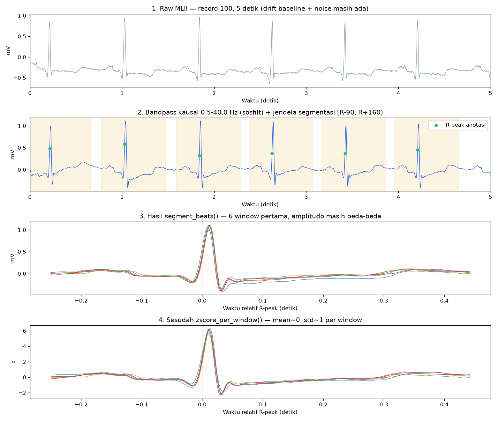
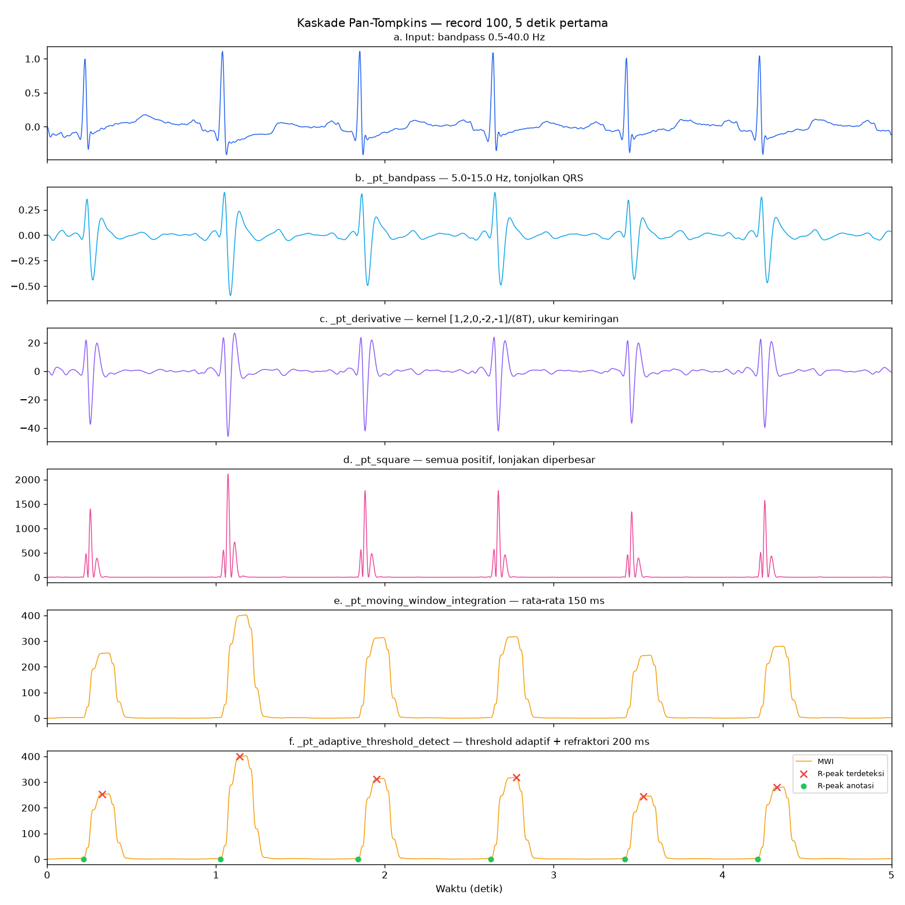

# Walkthrough `src/preprocessing.py`: Phase 1

> **Scope:** causal bandpass, the Pan-Tompkins detector, per-beat segmentation, and per-window z-score normalization.
> **Related code:** `src/preprocessing.py`, `config.py` (`BANDPASS_*`, `PT_*`, `WIN_PRE`, `WIN_POST`), `scripts/plot_phase1.py`, `scripts/plot_phase1_segment.py`, `scripts/bench_pantompkins.py`, `scripts/plot_walkthrough.py`
> **Prerequisite:** [`io-mitdb-walkthrough.md`](io-mitdb-walkthrough.md)

A study document, not a specification. The official specification remains
`PRD_Model_Aritmia_TinyML.pdf` pp. 7–9. Continues from
[`io-mitdb-walkthrough.md`](io-mitdb-walkthrough.md) (Phase 0). All numbers and figures here come from
**record 100, the first 5 seconds** (`fs = 360 Hz` → 1800 samples).

Reproducing the figures:

```
cd model
.venv/bin/python scripts/plot_walkthrough.py 100
```

> Formulas are written in LaTeX (`$…$`). If your viewer does not render math (the built-in VS Code preview
> needs the "Markdown+Math" extension), open it on GitHub or use
> `Markdown Preview Enhanced`.

---

## 0. The big picture: there are TWO paths, do not mix them up

```
                      load_record()  →  raw signal + r_locations (ANNOTATION)
                             │
                             ▼
        ┌──── apply_bandpass(signal, design_bandpass_sos())   ◄── 0.5–40 Hz
        │                    │
        │  TRAINING PATH     ├──► segment_beats(filtered, r_locations)   ◄── R from the annotation
        │                    │            │
        │                    │            ▼
        │                    │      zscore_per_window(...)  ──► (N, 256) float32 → Phase 2
        │                    │
        └──── BENCHMARK PATH └──► pan_tompkins_detect(filtered)  ──► detected R indices
                                        (compared with the annotation, NOT used in training)
```

Why they are separate: training segmentation uses the **cardiologist-annotated** R-peaks so that
detector errors do not contaminate the model's labels (a locked decision, PRD Phase 2).
Pan-Tompkins is in the same file because it is the detector that runs on the
ESP32 (C port: `ecg_detect_r`). The Python version serves as the reference for **how accurate
it is** and as the source of the golden reference for the C port.



---

## 1. `design_bandpass_sos()`: designing the Butterworth filter

```python
sos = butter(BANDPASS_ORDER, [BANDPASS_LOW, BANDPASS_HIGH],
             btype="bandpass", fs=FS, output="sos")
```

### Why a 0.5–40 Hz bandpass

A raw ECG signal = QRS (5–15 Hz) + P/T waves (0.5–10 Hz) + junk:

| Disturbance | Frequency | Removed by |
|---|---|---|
| Baseline wander (breathing, electrode movement) | < 0.5 Hz | highpass 0.5 Hz |
| EMG / muscle noise | > 40 Hz | lowpass 40 Hz |
| Mains electrical interference | 50/60 Hz | lowpass 40 Hz |

See panel 1 vs 2 in the figure: the baseline drifting at $-0.3$ mV becomes flat at
zero. In numbers: raw `mean` $= -0.3063$ → filtered $= +0.0000$.

### Butterworth mathematics

The magnitude response of an order-$n$ Butterworth lowpass with cutoff $\omega_c$:

$$|H(j\omega)|^2 = \frac{1}{1 + \left(\dfrac{\omega}{\omega_c}\right)^{2n}}$$

Its property: **maximally flat** in the passband (no ripple, unlike Chebyshev),
roll-off $-20n$ dB/decade. Order 4 → $-80$ dB/decade. The bandpass is made by the
lowpass→bandpass frequency transform, so the effective order becomes $2n = 8$
(8 poles), which in SciPy becomes 4 second-order sections.

### Why `output="sos"` and not `"ba"`

The `ba` form = a single order-8 polynomial. Its coefficients differ by orders of magnitude,
so float rounding error can make the filter **unstable**. SOS breaks it into a
cascade of biquads:

$$H(z) = \prod_{k=1}^{4} \frac{b_{0k} + b_{1k}z^{-1} + b_{2k}z^{-2}}{1 + a_{1k}z^{-1} + a_{2k}z^{-2}}$$

Each section is only order 2, so it is numerically safe. Bonus: this format is exactly what the
C firmware uses, as 4 chained biquads.

---

## 2. `apply_bandpass()`: running the filter

```python
return sosfilt(sos, signal, axis=0, zi=None)
```

One biquad section = a difference equation:

$$y[n] = b_0 x[n] + b_1 x[n-1] + b_2 x[n-2] - a_1 y[n-1] - a_2 y[n-2]$$

Note: **only indices $\le n$**. That is the definition of *causal*: the current output
needs only the past.

### PRD PITFALL #1: `sosfilt`, NOT `filtfilt`

`filtfilt` filters forward and then **backward** ($y[n]$ needs $x[n+k]$). The result is
zero-phase, which looks pretty on a plot, but needs the entire signal stored.
On an ESP32 that streams samples one at a time, that is impossible. If training uses
`filtfilt` and the device uses causal filtering, the model's input distribution differs and accuracy collapses
in the field (*train/deploy mismatch*).

The price we pay: **group delay**. A causal filter shifts the signal to the right.
That is not a problem for classification (all beats are shifted equally), but it becomes
important in Pan-Tompkins; see §3.6.

### Quick check

```python
np.allclose(sosfilt(sos, x)[:100], sosfilt(sos, x[:100]))   # True — causal
```
If the early part of the filter result changes when the signal is extended, it means it leaks
into the future (a bug).

---

## 3. Pan-Tompkins: a 5-stage cascade



The basic idea: a QRS is a **steep spike lasting ~80–120 ms**. If we make a
derivative signal, square it, and then smooth it, the QRS becomes one fat hill that is
easy to separate with a threshold, while P/T (gentle) and noise (narrow)
sink away.

### 3.1 `_pt_bandpass`: 5–15 Hz

```python
sos = butter(PT_BAND_ORDER, [PT_BAND_LOW, PT_BAND_HIGH], btype="bandpass", fs=fs, output="sos")
```

A **second** bandpass, narrower than the one in §1. Its purpose is different: §1 cleans the
signal to be *seen by the model*; this one emphasizes the QRS energy band to be *detected*.
Panel (b): the T wave that was clear becomes small, while the QRS stays dominant.

Order 2 (not 4): enough, and the lower the order, the smaller the delay.

### 3.2 `_pt_derivative`: measuring slope

The classic Pan-Tompkins kernel:

$$y[n] = \frac{1}{8T}\bigl(-x[n-2] - 2x[n-1] + 2x[n+1] + x[n+2]\bigr)$$

That is **non-causal** (it has $x[n+1]$, $x[n+2]$). The trick in the code: shift by 2 samples so that
it becomes causal:

```python
b = np.array([1, 2, 0, -2, -1], dtype=np.float64) / (8 * T)
lfilter(b, [1.0], signal)
```

which implements

$$y[n] = \frac{1}{8T}\bigl(x[n] + 2x[n-1] - 2x[n-3] - x[n-4]\bigr)$$

The shape is identical, just **delayed by 2 samples** ($\approx 5.6$ ms). This is an approximation of the
central-difference derivative: $y \approx \dfrac{dx}{dt}$, in units of mV/second, which is why the
y-axis of panel (c) jumps to the tens.

The derivative is used because the QRS has the steepest slope in the whole ECG. The T wave is large
but gentle → its derivative is small → automatically suppressed.

### 3.3 `_pt_square`: squaring

$$y[n] = x[n]^2$$

Two effects: (1) everything becomes positive, so rising slope and falling slope both
contribute; (2) it is non-linear: large values are amplified more than small ones.
The QRS : noise ratio grows quadratically as well. Panel (d): $\pm 45$ becomes $\approx 2000$.

### 3.4 `_pt_moving_window_integration`: smoothing over 150 ms

```python
n = max(1, round(PT_MWI_WINDOW_MS / 1000 * fs))   # 150 ms * 360 Hz = 54 samples
b = np.ones(n, dtype=np.float64) / n
lfilter(b, [1.0], signal)
```

A causal moving average:

$$y[n] = \frac{1}{N}\sum_{k=0}^{N-1} x[n-k], \qquad N = 54$$

Panel (d) has 2–3 spikes per QRS (rising slope, falling slope). After smoothing,
they merge into a **single hill** (panel e), much easier
to threshold. The window width is deliberately $\approx$ the QRS width: if too narrow,
the hill still splits; too wide, the QRS and T wave can merge.

### 3.5 `_pt_adaptive_threshold_detect`: picking the peaks

A fixed threshold does not work: ECG amplitude changes between patients, even
between minutes. Pan-Tompkins uses two running estimators:

- $\text{SPKI}$: the signal (QRS) peak level
- $\text{NPKI}$: the noise peak level

The threshold:

$$\text{THRESHOLD}_1 = \text{NPKI} + 0.25\,(\text{SPKI} - \text{NPKI})$$

that is, 25% of the way from the noise floor to the signal level. Each local peak
candidate $x$ updates one of the estimators with an exponential low-pass:

$$\text{SPKI} \leftarrow 0.125\,x + 0.875\,\text{SPKI} \quad \text{(if } x > \text{THRESHOLD}_1\text{)}$$
$$\text{NPKI} \leftarrow 0.125\,x + 0.875\,\text{NPKI} \quad \text{(otherwise)}$$

The constant $0.125 = 1/8$ → slow adaptation (time constant $\approx 8$ peaks),
so one large artifact does not immediately wreck the threshold.

Peak candidates are found vectorized, not in a loop:

```python
candidates = np.where(
    (integrated[1:-1] > integrated[:-2]) & (integrated[1:-1] >= integrated[2:])
)[0] + 1
```

Read: sample $i$ is a local peak if $x_{i-1} < x_i \ge x_{i+1}$. Asymmetric
(`>` on the left, `>=` on the right) so that a flat plateau yields neither zero
peaks nor double peaks. `+ 1` restores the offset caused by the `[1:-1]` slicing.

Initialization from the first 2 seconds:

```python
init_n = min(n, 2 * fs)            # assumes at least 1 QRS within 2 seconds
spki = float(np.max(integrated[:init_n]))
npki = float(np.mean(integrated[:init_n]))
```

**Refractory period**, the physiological period when the heart cannot depolarize again:

$$i - i_{\text{last}} \ge \frac{200\,\text{ms}}{1000}\,f_s = 72\ \text{samples}$$

200 ms $\Rightarrow$ a maximum of 300 bpm. This is what prevents one QRS from being counted twice
(e.g. closely spaced R and S waves).

### 3.6 What you should notice from the figure

In panel (f): the red crosses (detections) are **consistently to the right** of the green dots
(annotations). The median delay measured is **40 samples = 111 ms**, and that is not a bug: it is the
sum of the 5–15 Hz bandpass group delay + 2 derivative samples + $\approx N/2 = 27$
MWI samples. The consequences:

- For the benchmark, the $\pm 150$ ms tolerance (`bench_pantompkins.py`) covers this delay.
- On-device segmentation uses Pan-Tompkins, so **this delay is compensated**
  (the index is shifted left by `PT_DETECTOR_OFFSET = 38`, the DS1 median) before the
  window is cut. Without compensation, the window is systematically shifted from what the
  model saw during training. Details:
  [`detection-segmentation-walkthrough.md`](detection-segmentation-walkthrough.md).

Record 100 score: `TP=2263  FN=10  FP=9` → sensitivity 0.996,
precision 0.996.

---

## 4. `segment_beats()`: cutting per beat

```python
start, end = r - WIN_PRE, r + WIN_POST      # 128 before, 128 after
if start < 0 or end > len(signal): continue
```

Each beat becomes a window $[R-128,\ R+128)$ = **256 samples = 711 ms**, with the
annotated R-peak always at index 128 (in the filtered signal, the peak appears
at index 132 because of the +4 sample group delay). This fixed alignment matters: a 1-D CNN
learns patterns relative to position, so if the R-peak wanders from sample to sample,
the model has to waste capacity learning shift invariance.

Window coverage relative to the anatomy of one beat:

| Part | Approximate duration | In the window? |
|---|---|---|
| Baseline + P wave + PR interval | ~200 ms | yes (128 samples = 356 ms) |
| QRS | 80–120 ms | yes |
| ST segment + T wave | ~300–400 ms | mostly (128 samples = 356 ms) |

The T wave has to be included because its morphology distinguishes PVC from normal beats.
The left side is deliberately as long as the right side: supraventricular beats are distinguished
by the P wave and PR interval, and the model needs the P **together with the preceding baseline**
to recognize it as a P.

**Alternative not used.** The asymmetric window 90/160 (250 samples), which
has longer T coverage, lost in a 3-seed ablation: DS2 F1 0.5660 vs 0.6911
for 128/128. The 112/144 variant (also 256 samples, also a multiple of 8, longer T
coverage) is on par with 90/160, so what decides is the **128-sample context before
R**, not the window length. S recall rises monotonically with `WIN_PRE` (90 → 0.268,
112 → 0.369, 128 → 0.42–0.49), at the price of F recall falling (0.308 → 0.15–0.20)
because the T coverage is trimmed. Full data:
[`jitter-walkthrough.md`](jitter-walkthrough.md) §5–6.

The `start < 0 or end > len(signal)` guard drops beats at the edge of the recording. Record 100:
**2 of 2273 beats dropped** (index 77 at the start, 649991 at the end of 650000
samples) → 2271 windows remain. The `len(window) != WIN_LEN` check afterwards is redundant
logically, but cheap, and it keeps the `(N, 256)` contract from lying.

It returns `np.empty((0, WIN_LEN))` when empty, not `[]`, so that `.shape[1]` downstream
stays valid and no None check is needed.

---

## 5. `zscore_per_window()`: per-beat normalization

$$z_i[n] = \frac{x_i[n] - \mu_i}{\sigma_i + \varepsilon}, \qquad
\mu_i = \frac{1}{L}\sum_{n} x_i[n], \quad
\sigma_i = \sqrt{\frac{1}{L}\sum_n (x_i[n]-\mu_i)^2}$$

with $L = 256$, $\varepsilon = 10^{-8}$.

```python
mean = windows.mean(axis=1, keepdims=True)   # (N, 1) — per window, bukan global
```

`axis=1` = statistics are computed **per row**. This is a locked decision, and
there are two reasons:

1. **Immune to amplitude differences.** Electrode gain, skin impedance, and lead position
   give patient A a 1.2 mV QRS while patient B has 0.4 mV. After per-window
   z-scoring, both become comparable shapes, and the model learns *morphology*,
   not *how large the signal is*.
2. **Zero statistical leakage.** If $\mu,\sigma$ were computed from the whole training
   dataset, those statistics would carry over to the test set → *data leakage*. Per-window needs
   nothing from outside that window, so it can be computed on the fly on the device too.

$\varepsilon$ prevents division by zero on a flat window (electrode detached → constant
signal → $\sigma = 0$). Without it, one broken window yields `NaN` that
spreads through the whole training gradient.

Panel 3 vs 4 in the first figure: the shape is identical, only the scale changes, from
mV to units of "how many standard deviations". Verification: `z.mean() = -0.0000`,
`z.std() = 1.0000`.

The `float32` cast at the end: half the memory of `float64` and the same format as the
TFLite input.

---

## 6. Record 100 numbers (quick reference)

```
anotasi          = 2273 beat        window valid = 2271   dibuang = 2
raw      mean = -0.3063   std = 0.1932
filtered mean = +0.0000   std = 0.1840
z-score  mean = -0.0000   std = 1.0000
Pan-Tompkins: TP=2263  FN=10  FP=9  → Se=0.996  P+=0.996  (±150 ms)
delay deteksi median = 40 sampel = 111 ms
```

---

## 7. Comprehension check

1. If `BANDPASS_ORDER` is changed from 4 → 2, what changes in the PSD panel of
   `make plot1`, and why does that matter for the port to C?
2. Why may `_pt_derivative` be shifted by 2 samples without breaking detection, but
   `filtfilt` must not be used at all? (Hint: constant vs
   future-dependent.)
3. `WIN_POST` is raised from 128 → 200. How many beats are dropped in record 100, and
   what part of the waveform starts to be covered?
4. If `zscore_per_window` is replaced with global normalization (one $\mu,\sigma$ for
   all windows), which metric rises falsely in inter-patient evaluation?

## 8. Supporting scripts

| Command | Looks at |
|---|---|
| `python scripts/plot_phase1.py 100` | Time domain + spectrogram + PSD before/after the filter |
| `python scripts/plot_phase1_segment.py 100` | 8 windows, before vs after z-score |
| `python scripts/bench_pantompkins.py 100` | Detection vs annotation + Se/P+ |
| `python scripts/plot_walkthrough.py 100` | The two figures in this document |

---

**[← Phase 0: io_mitdb](io-mitdb-walkthrough.md)**  ·  [Walkthrough map](README.md)  ·  **[Phase 2: features_rr →](features-rr-walkthrough.md)**
